# 大きなファイルのサンプル

## セクション 1

これは段落 1 です。**太字**や *斜体*、`code`、[リンク](https://example.com) を含みます。

- 項目 A
- 項目 B
  - ネスト
- [ ] タスク

| 列 1 | 列 2 | 列 3 |
| --- | --- | --- |
| 1 | 2 | 3 |

## セクション 2

これは段落 2 です。**太字**や *斜体*、`code`、[リンク](https://example.com) を含みます。

- 項目 A
- 項目 B
  - ネスト
- [ ] タスク

| 列 1 | 列 2 | 列 3 |
| --- | --- | --- |
| 2 | 4 | 6 |

## セクション 3

これは段落 3 です。**太字**や *斜体*、`code`、[リンク](https://example.com) を含みます。

- 項目 A
- 項目 B
  - ネスト
- [ ] タスク

| 列 1 | 列 2 | 列 3 |
| --- | --- | --- |
| 3 | 6 | 9 |

## セクション 4

これは段落 4 です。**太字**や *斜体*、`code`、[リンク](https://example.com) を含みます。

- 項目 A
- 項目 B
  - ネスト
- [ ] タスク

| 列 1 | 列 2 | 列 3 |
| --- | --- | --- |
| 4 | 8 | 12 |

## セクション 5

これは段落 5 です。**太字**や *斜体*、`code`、[リンク](https://example.com) を含みます。

- 項目 A
- 項目 B
  - ネスト
- [ ] タスク

| 列 1 | 列 2 | 列 3 |
| --- | --- | --- |
| 5 | 10 | 15 |

## セクション 6

これは段落 6 です。**太字**や *斜体*、`code`、[リンク](https://example.com) を含みます。

- 項目 A
- 項目 B
  - ネスト
- [ ] タスク

| 列 1 | 列 2 | 列 3 |
| --- | --- | --- |
| 6 | 12 | 18 |

## セクション 7

これは段落 7 です。**太字**や *斜体*、`code`、[リンク](https://example.com) を含みます。

- 項目 A
- 項目 B
  - ネスト
- [ ] タスク

| 列 1 | 列 2 | 列 3 |
| --- | --- | --- |
| 7 | 14 | 21 |

## セクション 8

これは段落 8 です。**太字**や *斜体*、`code`、[リンク](https://example.com) を含みます。

- 項目 A
- 項目 B
  - ネスト
- [ ] タスク

| 列 1 | 列 2 | 列 3 |
| --- | --- | --- |
| 8 | 16 | 24 |

## セクション 9

これは段落 9 です。**太字**や *斜体*、`code`、[リンク](https://example.com) を含みます。

- 項目 A
- 項目 B
  - ネスト
- [ ] タスク

| 列 1 | 列 2 | 列 3 |
| --- | --- | --- |
| 9 | 18 | 27 |

## セクション 10

これは段落 10 です。**太字**や *斜体*、`code`、[リンク](https://example.com) を含みます。

- 項目 A
- 項目 B
  - ネスト
- [ ] タスク

| 列 1 | 列 2 | 列 3 |
| --- | --- | --- |
| 10 | 20 | 30 |

```js
function f10(x) {
  return x * 10
}
```

## セクション 11

これは段落 11 です。**太字**や *斜体*、`code`、[リンク](https://example.com) を含みます。

- 項目 A
- 項目 B
  - ネスト
- [ ] タスク

| 列 1 | 列 2 | 列 3 |
| --- | --- | --- |
| 11 | 22 | 33 |

## セクション 12

これは段落 12 です。**太字**や *斜体*、`code`、[リンク](https://example.com) を含みます。

- 項目 A
- 項目 B
  - ネスト
- [ ] タスク

| 列 1 | 列 2 | 列 3 |
| --- | --- | --- |
| 12 | 24 | 36 |

## セクション 13

これは段落 13 です。**太字**や *斜体*、`code`、[リンク](https://example.com) を含みます。

- 項目 A
- 項目 B
  - ネスト
- [ ] タスク

| 列 1 | 列 2 | 列 3 |
| --- | --- | --- |
| 13 | 26 | 39 |

## セクション 14

これは段落 14 です。**太字**や *斜体*、`code`、[リンク](https://example.com) を含みます。

- 項目 A
- 項目 B
  - ネスト
- [ ] タスク

| 列 1 | 列 2 | 列 3 |
| --- | --- | --- |
| 14 | 28 | 42 |

## セクション 15

これは段落 15 です。**太字**や *斜体*、`code`、[リンク](https://example.com) を含みます。

- 項目 A
- 項目 B
  - ネスト
- [ ] タスク

| 列 1 | 列 2 | 列 3 |
| --- | --- | --- |
| 15 | 30 | 45 |

数式 $x_{15} = \sqrt{15}$

## セクション 16

これは段落 16 です。**太字**や *斜体*、`code`、[リンク](https://example.com) を含みます。

- 項目 A
- 項目 B
  - ネスト
- [ ] タスク

| 列 1 | 列 2 | 列 3 |
| --- | --- | --- |
| 16 | 32 | 48 |

## セクション 17

これは段落 17 です。**太字**や *斜体*、`code`、[リンク](https://example.com) を含みます。

- 項目 A
- 項目 B
  - ネスト
- [ ] タスク

| 列 1 | 列 2 | 列 3 |
| --- | --- | --- |
| 17 | 34 | 51 |

## セクション 18

これは段落 18 です。**太字**や *斜体*、`code`、[リンク](https://example.com) を含みます。

- 項目 A
- 項目 B
  - ネスト
- [ ] タスク

| 列 1 | 列 2 | 列 3 |
| --- | --- | --- |
| 18 | 36 | 54 |

## セクション 19

これは段落 19 です。**太字**や *斜体*、`code`、[リンク](https://example.com) を含みます。

- 項目 A
- 項目 B
  - ネスト
- [ ] タスク

| 列 1 | 列 2 | 列 3 |
| --- | --- | --- |
| 19 | 38 | 57 |

## セクション 20

これは段落 20 です。**太字**や *斜体*、`code`、[リンク](https://example.com) を含みます。

- 項目 A
- 項目 B
  - ネスト
- [ ] タスク

| 列 1 | 列 2 | 列 3 |
| --- | --- | --- |
| 20 | 40 | 60 |

```js
function f20(x) {
  return x * 20
}
```

## セクション 21

これは段落 21 です。**太字**や *斜体*、`code`、[リンク](https://example.com) を含みます。

- 項目 A
- 項目 B
  - ネスト
- [ ] タスク

| 列 1 | 列 2 | 列 3 |
| --- | --- | --- |
| 21 | 42 | 63 |

## セクション 22

これは段落 22 です。**太字**や *斜体*、`code`、[リンク](https://example.com) を含みます。

- 項目 A
- 項目 B
  - ネスト
- [ ] タスク

| 列 1 | 列 2 | 列 3 |
| --- | --- | --- |
| 22 | 44 | 66 |

## セクション 23

これは段落 23 です。**太字**や *斜体*、`code`、[リンク](https://example.com) を含みます。

- 項目 A
- 項目 B
  - ネスト
- [ ] タスク

| 列 1 | 列 2 | 列 3 |
| --- | --- | --- |
| 23 | 46 | 69 |

## セクション 24

これは段落 24 です。**太字**や *斜体*、`code`、[リンク](https://example.com) を含みます。

- 項目 A
- 項目 B
  - ネスト
- [ ] タスク

| 列 1 | 列 2 | 列 3 |
| --- | --- | --- |
| 24 | 48 | 72 |

## セクション 25

これは段落 25 です。**太字**や *斜体*、`code`、[リンク](https://example.com) を含みます。

- 項目 A
- 項目 B
  - ネスト
- [ ] タスク

| 列 1 | 列 2 | 列 3 |
| --- | --- | --- |
| 25 | 50 | 75 |

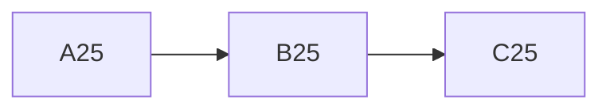

## セクション 26

これは段落 26 です。**太字**や *斜体*、`code`、[リンク](https://example.com) を含みます。

- 項目 A
- 項目 B
  - ネスト
- [ ] タスク

| 列 1 | 列 2 | 列 3 |
| --- | --- | --- |
| 26 | 52 | 78 |

## セクション 27

これは段落 27 です。**太字**や *斜体*、`code`、[リンク](https://example.com) を含みます。

- 項目 A
- 項目 B
  - ネスト
- [ ] タスク

| 列 1 | 列 2 | 列 3 |
| --- | --- | --- |
| 27 | 54 | 81 |

## セクション 28

これは段落 28 です。**太字**や *斜体*、`code`、[リンク](https://example.com) を含みます。

- 項目 A
- 項目 B
  - ネスト
- [ ] タスク

| 列 1 | 列 2 | 列 3 |
| --- | --- | --- |
| 28 | 56 | 84 |

## セクション 29

これは段落 29 です。**太字**や *斜体*、`code`、[リンク](https://example.com) を含みます。

- 項目 A
- 項目 B
  - ネスト
- [ ] タスク

| 列 1 | 列 2 | 列 3 |
| --- | --- | --- |
| 29 | 58 | 87 |

## セクション 30

これは段落 30 です。**太字**や *斜体*、`code`、[リンク](https://example.com) を含みます。

- 項目 A
- 項目 B
  - ネスト
- [ ] タスク

| 列 1 | 列 2 | 列 3 |
| --- | --- | --- |
| 30 | 60 | 90 |

```js
function f30(x) {
  return x * 30
}
```

数式 $x_{30} = \sqrt{30}$

## セクション 31

これは段落 31 です。**太字**や *斜体*、`code`、[リンク](https://example.com) を含みます。

- 項目 A
- 項目 B
  - ネスト
- [ ] タスク

| 列 1 | 列 2 | 列 3 |
| --- | --- | --- |
| 31 | 62 | 93 |

## セクション 32

これは段落 32 です。**太字**や *斜体*、`code`、[リンク](https://example.com) を含みます。

- 項目 A
- 項目 B
  - ネスト
- [ ] タスク

| 列 1 | 列 2 | 列 3 |
| --- | --- | --- |
| 32 | 64 | 96 |

## セクション 33

これは段落 33 です。**太字**や *斜体*、`code`、[リンク](https://example.com) を含みます。

- 項目 A
- 項目 B
  - ネスト
- [ ] タスク

| 列 1 | 列 2 | 列 3 |
| --- | --- | --- |
| 33 | 66 | 99 |

## セクション 34

これは段落 34 です。**太字**や *斜体*、`code`、[リンク](https://example.com) を含みます。

- 項目 A
- 項目 B
  - ネスト
- [ ] タスク

| 列 1 | 列 2 | 列 3 |
| --- | --- | --- |
| 34 | 68 | 102 |

## セクション 35

これは段落 35 です。**太字**や *斜体*、`code`、[リンク](https://example.com) を含みます。

- 項目 A
- 項目 B
  - ネスト
- [ ] タスク

| 列 1 | 列 2 | 列 3 |
| --- | --- | --- |
| 35 | 70 | 105 |

## セクション 36

これは段落 36 です。**太字**や *斜体*、`code`、[リンク](https://example.com) を含みます。

- 項目 A
- 項目 B
  - ネスト
- [ ] タスク

| 列 1 | 列 2 | 列 3 |
| --- | --- | --- |
| 36 | 72 | 108 |

## セクション 37

これは段落 37 です。**太字**や *斜体*、`code`、[リンク](https://example.com) を含みます。

- 項目 A
- 項目 B
  - ネスト
- [ ] タスク

| 列 1 | 列 2 | 列 3 |
| --- | --- | --- |
| 37 | 74 | 111 |

## セクション 38

これは段落 38 です。**太字**や *斜体*、`code`、[リンク](https://example.com) を含みます。

- 項目 A
- 項目 B
  - ネスト
- [ ] タスク

| 列 1 | 列 2 | 列 3 |
| --- | --- | --- |
| 38 | 76 | 114 |

## セクション 39

これは段落 39 です。**太字**や *斜体*、`code`、[リンク](https://example.com) を含みます。

- 項目 A
- 項目 B
  - ネスト
- [ ] タスク

| 列 1 | 列 2 | 列 3 |
| --- | --- | --- |
| 39 | 78 | 117 |

## セクション 40

これは段落 40 です。**太字**や *斜体*、`code`、[リンク](https://example.com) を含みます。

- 項目 A
- 項目 B
  - ネスト
- [ ] タスク

| 列 1 | 列 2 | 列 3 |
| --- | --- | --- |
| 40 | 80 | 120 |

```js
function f40(x) {
  return x * 40
}
```

## セクション 41

これは段落 41 です。**太字**や *斜体*、`code`、[リンク](https://example.com) を含みます。

- 項目 A
- 項目 B
  - ネスト
- [ ] タスク

| 列 1 | 列 2 | 列 3 |
| --- | --- | --- |
| 41 | 82 | 123 |

## セクション 42

これは段落 42 です。**太字**や *斜体*、`code`、[リンク](https://example.com) を含みます。

- 項目 A
- 項目 B
  - ネスト
- [ ] タスク

| 列 1 | 列 2 | 列 3 |
| --- | --- | --- |
| 42 | 84 | 126 |

## セクション 43

これは段落 43 です。**太字**や *斜体*、`code`、[リンク](https://example.com) を含みます。

- 項目 A
- 項目 B
  - ネスト
- [ ] タスク

| 列 1 | 列 2 | 列 3 |
| --- | --- | --- |
| 43 | 86 | 129 |

## セクション 44

これは段落 44 です。**太字**や *斜体*、`code`、[リンク](https://example.com) を含みます。

- 項目 A
- 項目 B
  - ネスト
- [ ] タスク

| 列 1 | 列 2 | 列 3 |
| --- | --- | --- |
| 44 | 88 | 132 |

## セクション 45

これは段落 45 です。**太字**や *斜体*、`code`、[リンク](https://example.com) を含みます。

- 項目 A
- 項目 B
  - ネスト
- [ ] タスク

| 列 1 | 列 2 | 列 3 |
| --- | --- | --- |
| 45 | 90 | 135 |

数式 $x_{45} = \sqrt{45}$

## セクション 46

これは段落 46 です。**太字**や *斜体*、`code`、[リンク](https://example.com) を含みます。

- 項目 A
- 項目 B
  - ネスト
- [ ] タスク

| 列 1 | 列 2 | 列 3 |
| --- | --- | --- |
| 46 | 92 | 138 |

## セクション 47

これは段落 47 です。**太字**や *斜体*、`code`、[リンク](https://example.com) を含みます。

- 項目 A
- 項目 B
  - ネスト
- [ ] タスク

| 列 1 | 列 2 | 列 3 |
| --- | --- | --- |
| 47 | 94 | 141 |

## セクション 48

これは段落 48 です。**太字**や *斜体*、`code`、[リンク](https://example.com) を含みます。

- 項目 A
- 項目 B
  - ネスト
- [ ] タスク

| 列 1 | 列 2 | 列 3 |
| --- | --- | --- |
| 48 | 96 | 144 |

## セクション 49

これは段落 49 です。**太字**や *斜体*、`code`、[リンク](https://example.com) を含みます。

- 項目 A
- 項目 B
  - ネスト
- [ ] タスク

| 列 1 | 列 2 | 列 3 |
| --- | --- | --- |
| 49 | 98 | 147 |

## セクション 50

これは段落 50 です。**太字**や *斜体*、`code`、[リンク](https://example.com) を含みます。

- 項目 A
- 項目 B
  - ネスト
- [ ] タスク

| 列 1 | 列 2 | 列 3 |
| --- | --- | --- |
| 50 | 100 | 150 |

```js
function f50(x) {
  return x * 50
}
```

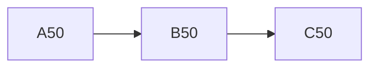

## セクション 51

これは段落 51 です。**太字**や *斜体*、`code`、[リンク](https://example.com) を含みます。

- 項目 A
- 項目 B
  - ネスト
- [ ] タスク

| 列 1 | 列 2 | 列 3 |
| --- | --- | --- |
| 51 | 102 | 153 |

## セクション 52

これは段落 52 です。**太字**や *斜体*、`code`、[リンク](https://example.com) を含みます。

- 項目 A
- 項目 B
  - ネスト
- [ ] タスク

| 列 1 | 列 2 | 列 3 |
| --- | --- | --- |
| 52 | 104 | 156 |

## セクション 53

これは段落 53 です。**太字**や *斜体*、`code`、[リンク](https://example.com) を含みます。

- 項目 A
- 項目 B
  - ネスト
- [ ] タスク

| 列 1 | 列 2 | 列 3 |
| --- | --- | --- |
| 53 | 106 | 159 |

## セクション 54

これは段落 54 です。**太字**や *斜体*、`code`、[リンク](https://example.com) を含みます。

- 項目 A
- 項目 B
  - ネスト
- [ ] タスク

| 列 1 | 列 2 | 列 3 |
| --- | --- | --- |
| 54 | 108 | 162 |

## セクション 55

これは段落 55 です。**太字**や *斜体*、`code`、[リンク](https://example.com) を含みます。

- 項目 A
- 項目 B
  - ネスト
- [ ] タスク

| 列 1 | 列 2 | 列 3 |
| --- | --- | --- |
| 55 | 110 | 165 |

## セクション 56

これは段落 56 です。**太字**や *斜体*、`code`、[リンク](https://example.com) を含みます。

- 項目 A
- 項目 B
  - ネスト
- [ ] タスク

| 列 1 | 列 2 | 列 3 |
| --- | --- | --- |
| 56 | 112 | 168 |

## セクション 57

これは段落 57 です。**太字**や *斜体*、`code`、[リンク](https://example.com) を含みます。

- 項目 A
- 項目 B
  - ネスト
- [ ] タスク

| 列 1 | 列 2 | 列 3 |
| --- | --- | --- |
| 57 | 114 | 171 |

## セクション 58

これは段落 58 です。**太字**や *斜体*、`code`、[リンク](https://example.com) を含みます。

- 項目 A
- 項目 B
  - ネスト
- [ ] タスク

| 列 1 | 列 2 | 列 3 |
| --- | --- | --- |
| 58 | 116 | 174 |

## セクション 59

これは段落 59 です。**太字**や *斜体*、`code`、[リンク](https://example.com) を含みます。

- 項目 A
- 項目 B
  - ネスト
- [ ] タスク

| 列 1 | 列 2 | 列 3 |
| --- | --- | --- |
| 59 | 118 | 177 |

## セクション 60

これは段落 60 です。**太字**や *斜体*、`code`、[リンク](https://example.com) を含みます。

- 項目 A
- 項目 B
  - ネスト
- [ ] タスク

| 列 1 | 列 2 | 列 3 |
| --- | --- | --- |
| 60 | 120 | 180 |

```js
function f60(x) {
  return x * 60
}
```

数式 $x_{60} = \sqrt{60}$

## セクション 61

これは段落 61 です。**太字**や *斜体*、`code`、[リンク](https://example.com) を含みます。

- 項目 A
- 項目 B
  - ネスト
- [ ] タスク

| 列 1 | 列 2 | 列 3 |
| --- | --- | --- |
| 61 | 122 | 183 |

## セクション 62

これは段落 62 です。**太字**や *斜体*、`code`、[リンク](https://example.com) を含みます。

- 項目 A
- 項目 B
  - ネスト
- [ ] タスク

| 列 1 | 列 2 | 列 3 |
| --- | --- | --- |
| 62 | 124 | 186 |

## セクション 63

これは段落 63 です。**太字**や *斜体*、`code`、[リンク](https://example.com) を含みます。

- 項目 A
- 項目 B
  - ネスト
- [ ] タスク

| 列 1 | 列 2 | 列 3 |
| --- | --- | --- |
| 63 | 126 | 189 |

## セクション 64

これは段落 64 です。**太字**や *斜体*、`code`、[リンク](https://example.com) を含みます。

- 項目 A
- 項目 B
  - ネスト
- [ ] タスク

| 列 1 | 列 2 | 列 3 |
| --- | --- | --- |
| 64 | 128 | 192 |

## セクション 65

これは段落 65 です。**太字**や *斜体*、`code`、[リンク](https://example.com) を含みます。

- 項目 A
- 項目 B
  - ネスト
- [ ] タスク

| 列 1 | 列 2 | 列 3 |
| --- | --- | --- |
| 65 | 130 | 195 |

## セクション 66

これは段落 66 です。**太字**や *斜体*、`code`、[リンク](https://example.com) を含みます。

- 項目 A
- 項目 B
  - ネスト
- [ ] タスク

| 列 1 | 列 2 | 列 3 |
| --- | --- | --- |
| 66 | 132 | 198 |

## セクション 67

これは段落 67 です。**太字**や *斜体*、`code`、[リンク](https://example.com) を含みます。

- 項目 A
- 項目 B
  - ネスト
- [ ] タスク

| 列 1 | 列 2 | 列 3 |
| --- | --- | --- |
| 67 | 134 | 201 |

## セクション 68

これは段落 68 です。**太字**や *斜体*、`code`、[リンク](https://example.com) を含みます。

- 項目 A
- 項目 B
  - ネスト
- [ ] タスク

| 列 1 | 列 2 | 列 3 |
| --- | --- | --- |
| 68 | 136 | 204 |

## セクション 69

これは段落 69 です。**太字**や *斜体*、`code`、[リンク](https://example.com) を含みます。

- 項目 A
- 項目 B
  - ネスト
- [ ] タスク

| 列 1 | 列 2 | 列 3 |
| --- | --- | --- |
| 69 | 138 | 207 |

## セクション 70

これは段落 70 です。**太字**や *斜体*、`code`、[リンク](https://example.com) を含みます。

- 項目 A
- 項目 B
  - ネスト
- [ ] タスク

| 列 1 | 列 2 | 列 3 |
| --- | --- | --- |
| 70 | 140 | 210 |

```js
function f70(x) {
  return x * 70
}
```

## セクション 71

これは段落 71 です。**太字**や *斜体*、`code`、[リンク](https://example.com) を含みます。

- 項目 A
- 項目 B
  - ネスト
- [ ] タスク

| 列 1 | 列 2 | 列 3 |
| --- | --- | --- |
| 71 | 142 | 213 |

## セクション 72

これは段落 72 です。**太字**や *斜体*、`code`、[リンク](https://example.com) を含みます。

- 項目 A
- 項目 B
  - ネスト
- [ ] タスク

| 列 1 | 列 2 | 列 3 |
| --- | --- | --- |
| 72 | 144 | 216 |

## セクション 73

これは段落 73 です。**太字**や *斜体*、`code`、[リンク](https://example.com) を含みます。

- 項目 A
- 項目 B
  - ネスト
- [ ] タスク

| 列 1 | 列 2 | 列 3 |
| --- | --- | --- |
| 73 | 146 | 219 |

## セクション 74

これは段落 74 です。**太字**や *斜体*、`code`、[リンク](https://example.com) を含みます。

- 項目 A
- 項目 B
  - ネスト
- [ ] タスク

| 列 1 | 列 2 | 列 3 |
| --- | --- | --- |
| 74 | 148 | 222 |

## セクション 75

これは段落 75 です。**太字**や *斜体*、`code`、[リンク](https://example.com) を含みます。

- 項目 A
- 項目 B
  - ネスト
- [ ] タスク

| 列 1 | 列 2 | 列 3 |
| --- | --- | --- |
| 75 | 150 | 225 |

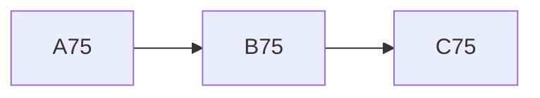

数式 $x_{75} = \sqrt{75}$

## セクション 76

これは段落 76 です。**太字**や *斜体*、`code`、[リンク](https://example.com) を含みます。

- 項目 A
- 項目 B
  - ネスト
- [ ] タスク

| 列 1 | 列 2 | 列 3 |
| --- | --- | --- |
| 76 | 152 | 228 |

## セクション 77

これは段落 77 です。**太字**や *斜体*、`code`、[リンク](https://example.com) を含みます。

- 項目 A
- 項目 B
  - ネスト
- [ ] タスク

| 列 1 | 列 2 | 列 3 |
| --- | --- | --- |
| 77 | 154 | 231 |

## セクション 78

これは段落 78 です。**太字**や *斜体*、`code`、[リンク](https://example.com) を含みます。

- 項目 A
- 項目 B
  - ネスト
- [ ] タスク

| 列 1 | 列 2 | 列 3 |
| --- | --- | --- |
| 78 | 156 | 234 |

## セクション 79

これは段落 79 です。**太字**や *斜体*、`code`、[リンク](https://example.com) を含みます。

- 項目 A
- 項目 B
  - ネスト
- [ ] タスク

| 列 1 | 列 2 | 列 3 |
| --- | --- | --- |
| 79 | 158 | 237 |

## セクション 80

これは段落 80 です。**太字**や *斜体*、`code`、[リンク](https://example.com) を含みます。

- 項目 A
- 項目 B
  - ネスト
- [ ] タスク

| 列 1 | 列 2 | 列 3 |
| --- | --- | --- |
| 80 | 160 | 240 |

```js
function f80(x) {
  return x * 80
}
```

## セクション 81

これは段落 81 です。**太字**や *斜体*、`code`、[リンク](https://example.com) を含みます。

- 項目 A
- 項目 B
  - ネスト
- [ ] タスク

| 列 1 | 列 2 | 列 3 |
| --- | --- | --- |
| 81 | 162 | 243 |

## セクション 82

これは段落 82 です。**太字**や *斜体*、`code`、[リンク](https://example.com) を含みます。

- 項目 A
- 項目 B
  - ネスト
- [ ] タスク

| 列 1 | 列 2 | 列 3 |
| --- | --- | --- |
| 82 | 164 | 246 |

## セクション 83

これは段落 83 です。**太字**や *斜体*、`code`、[リンク](https://example.com) を含みます。

- 項目 A
- 項目 B
  - ネスト
- [ ] タスク

| 列 1 | 列 2 | 列 3 |
| --- | --- | --- |
| 83 | 166 | 249 |

## セクション 84

これは段落 84 です。**太字**や *斜体*、`code`、[リンク](https://example.com) を含みます。

- 項目 A
- 項目 B
  - ネスト
- [ ] タスク

| 列 1 | 列 2 | 列 3 |
| --- | --- | --- |
| 84 | 168 | 252 |

## セクション 85

これは段落 85 です。**太字**や *斜体*、`code`、[リンク](https://example.com) を含みます。

- 項目 A
- 項目 B
  - ネスト
- [ ] タスク

| 列 1 | 列 2 | 列 3 |
| --- | --- | --- |
| 85 | 170 | 255 |

## セクション 86

これは段落 86 です。**太字**や *斜体*、`code`、[リンク](https://example.com) を含みます。

- 項目 A
- 項目 B
  - ネスト
- [ ] タスク

| 列 1 | 列 2 | 列 3 |
| --- | --- | --- |
| 86 | 172 | 258 |

## セクション 87

これは段落 87 です。**太字**や *斜体*、`code`、[リンク](https://example.com) を含みます。

- 項目 A
- 項目 B
  - ネスト
- [ ] タスク

| 列 1 | 列 2 | 列 3 |
| --- | --- | --- |
| 87 | 174 | 261 |

## セクション 88

これは段落 88 です。**太字**や *斜体*、`code`、[リンク](https://example.com) を含みます。

- 項目 A
- 項目 B
  - ネスト
- [ ] タスク

| 列 1 | 列 2 | 列 3 |
| --- | --- | --- |
| 88 | 176 | 264 |

## セクション 89

これは段落 89 です。**太字**や *斜体*、`code`、[リンク](https://example.com) を含みます。

- 項目 A
- 項目 B
  - ネスト
- [ ] タスク

| 列 1 | 列 2 | 列 3 |
| --- | --- | --- |
| 89 | 178 | 267 |

## セクション 90

これは段落 90 です。**太字**や *斜体*、`code`、[リンク](https://example.com) を含みます。

- 項目 A
- 項目 B
  - ネスト
- [ ] タスク

| 列 1 | 列 2 | 列 3 |
| --- | --- | --- |
| 90 | 180 | 270 |

```js
function f90(x) {
  return x * 90
}
```

数式 $x_{90} = \sqrt{90}$

## セクション 91

これは段落 91 です。**太字**や *斜体*、`code`、[リンク](https://example.com) を含みます。

- 項目 A
- 項目 B
  - ネスト
- [ ] タスク

| 列 1 | 列 2 | 列 3 |
| --- | --- | --- |
| 91 | 182 | 273 |

## セクション 92

これは段落 92 です。**太字**や *斜体*、`code`、[リンク](https://example.com) を含みます。

- 項目 A
- 項目 B
  - ネスト
- [ ] タスク

| 列 1 | 列 2 | 列 3 |
| --- | --- | --- |
| 92 | 184 | 276 |

## セクション 93

これは段落 93 です。**太字**や *斜体*、`code`、[リンク](https://example.com) を含みます。

- 項目 A
- 項目 B
  - ネスト
- [ ] タスク

| 列 1 | 列 2 | 列 3 |
| --- | --- | --- |
| 93 | 186 | 279 |

## セクション 94

これは段落 94 です。**太字**や *斜体*、`code`、[リンク](https://example.com) を含みます。

- 項目 A
- 項目 B
  - ネスト
- [ ] タスク

| 列 1 | 列 2 | 列 3 |
| --- | --- | --- |
| 94 | 188 | 282 |

## セクション 95

これは段落 95 です。**太字**や *斜体*、`code`、[リンク](https://example.com) を含みます。

- 項目 A
- 項目 B
  - ネスト
- [ ] タスク

| 列 1 | 列 2 | 列 3 |
| --- | --- | --- |
| 95 | 190 | 285 |

## セクション 96

これは段落 96 です。**太字**や *斜体*、`code`、[リンク](https://example.com) を含みます。

- 項目 A
- 項目 B
  - ネスト
- [ ] タスク

| 列 1 | 列 2 | 列 3 |
| --- | --- | --- |
| 96 | 192 | 288 |

## セクション 97

これは段落 97 です。**太字**や *斜体*、`code`、[リンク](https://example.com) を含みます。

- 項目 A
- 項目 B
  - ネスト
- [ ] タスク

| 列 1 | 列 2 | 列 3 |
| --- | --- | --- |
| 97 | 194 | 291 |

## セクション 98

これは段落 98 です。**太字**や *斜体*、`code`、[リンク](https://example.com) を含みます。

- 項目 A
- 項目 B
  - ネスト
- [ ] タスク

| 列 1 | 列 2 | 列 3 |
| --- | --- | --- |
| 98 | 196 | 294 |

## セクション 99

これは段落 99 です。**太字**や *斜体*、`code`、[リンク](https://example.com) を含みます。

- 項目 A
- 項目 B
  - ネスト
- [ ] タスク

| 列 1 | 列 2 | 列 3 |
| --- | --- | --- |
| 99 | 198 | 297 |

## セクション 100

これは段落 100 です。**太字**や *斜体*、`code`、[リンク](https://example.com) を含みます。

- 項目 A
- 項目 B
  - ネスト
- [ ] タスク

| 列 1 | 列 2 | 列 3 |
| --- | --- | --- |
| 100 | 200 | 300 |

```js
function f100(x) {
  return x * 100
}
```

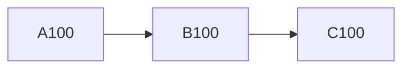

## セクション 101

これは段落 101 です。**太字**や *斜体*、`code`、[リンク](https://example.com) を含みます。

- 項目 A
- 項目 B
  - ネスト
- [ ] タスク

| 列 1 | 列 2 | 列 3 |
| --- | --- | --- |
| 101 | 202 | 303 |

## セクション 102

これは段落 102 です。**太字**や *斜体*、`code`、[リンク](https://example.com) を含みます。

- 項目 A
- 項目 B
  - ネスト
- [ ] タスク

| 列 1 | 列 2 | 列 3 |
| --- | --- | --- |
| 102 | 204 | 306 |

## セクション 103

これは段落 103 です。**太字**や *斜体*、`code`、[リンク](https://example.com) を含みます。

- 項目 A
- 項目 B
  - ネスト
- [ ] タスク

| 列 1 | 列 2 | 列 3 |
| --- | --- | --- |
| 103 | 206 | 309 |

## セクション 104

これは段落 104 です。**太字**や *斜体*、`code`、[リンク](https://example.com) を含みます。

- 項目 A
- 項目 B
  - ネスト
- [ ] タスク

| 列 1 | 列 2 | 列 3 |
| --- | --- | --- |
| 104 | 208 | 312 |

## セクション 105

これは段落 105 です。**太字**や *斜体*、`code`、[リンク](https://example.com) を含みます。

- 項目 A
- 項目 B
  - ネスト
- [ ] タスク

| 列 1 | 列 2 | 列 3 |
| --- | --- | --- |
| 105 | 210 | 315 |

数式 $x_{105} = \sqrt{105}$

## セクション 106

これは段落 106 です。**太字**や *斜体*、`code`、[リンク](https://example.com) を含みます。

- 項目 A
- 項目 B
  - ネスト
- [ ] タスク

| 列 1 | 列 2 | 列 3 |
| --- | --- | --- |
| 106 | 212 | 318 |

## セクション 107

これは段落 107 です。**太字**や *斜体*、`code`、[リンク](https://example.com) を含みます。

- 項目 A
- 項目 B
  - ネスト
- [ ] タスク

| 列 1 | 列 2 | 列 3 |
| --- | --- | --- |
| 107 | 214 | 321 |

## セクション 108

これは段落 108 です。**太字**や *斜体*、`code`、[リンク](https://example.com) を含みます。

- 項目 A
- 項目 B
  - ネスト
- [ ] タスク

| 列 1 | 列 2 | 列 3 |
| --- | --- | --- |
| 108 | 216 | 324 |

## セクション 109

これは段落 109 です。**太字**や *斜体*、`code`、[リンク](https://example.com) を含みます。

- 項目 A
- 項目 B
  - ネスト
- [ ] タスク

| 列 1 | 列 2 | 列 3 |
| --- | --- | --- |
| 109 | 218 | 327 |

## セクション 110

これは段落 110 です。**太字**や *斜体*、`code`、[リンク](https://example.com) を含みます。

- 項目 A
- 項目 B
  - ネスト
- [ ] タスク

| 列 1 | 列 2 | 列 3 |
| --- | --- | --- |
| 110 | 220 | 330 |

```js
function f110(x) {
  return x * 110
}
```

## セクション 111

これは段落 111 です。**太字**や *斜体*、`code`、[リンク](https://example.com) を含みます。

- 項目 A
- 項目 B
  - ネスト
- [ ] タスク

| 列 1 | 列 2 | 列 3 |
| --- | --- | --- |
| 111 | 222 | 333 |

## セクション 112

これは段落 112 です。**太字**や *斜体*、`code`、[リンク](https://example.com) を含みます。

- 項目 A
- 項目 B
  - ネスト
- [ ] タスク

| 列 1 | 列 2 | 列 3 |
| --- | --- | --- |
| 112 | 224 | 336 |

## セクション 113

これは段落 113 です。**太字**や *斜体*、`code`、[リンク](https://example.com) を含みます。

- 項目 A
- 項目 B
  - ネスト
- [ ] タスク

| 列 1 | 列 2 | 列 3 |
| --- | --- | --- |
| 113 | 226 | 339 |

## セクション 114

これは段落 114 です。**太字**や *斜体*、`code`、[リンク](https://example.com) を含みます。

- 項目 A
- 項目 B
  - ネスト
- [ ] タスク

| 列 1 | 列 2 | 列 3 |
| --- | --- | --- |
| 114 | 228 | 342 |

## セクション 115

これは段落 115 です。**太字**や *斜体*、`code`、[リンク](https://example.com) を含みます。

- 項目 A
- 項目 B
  - ネスト
- [ ] タスク

| 列 1 | 列 2 | 列 3 |
| --- | --- | --- |
| 115 | 230 | 345 |

## セクション 116

これは段落 116 です。**太字**や *斜体*、`code`、[リンク](https://example.com) を含みます。

- 項目 A
- 項目 B
  - ネスト
- [ ] タスク

| 列 1 | 列 2 | 列 3 |
| --- | --- | --- |
| 116 | 232 | 348 |

## セクション 117

これは段落 117 です。**太字**や *斜体*、`code`、[リンク](https://example.com) を含みます。

- 項目 A
- 項目 B
  - ネスト
- [ ] タスク

| 列 1 | 列 2 | 列 3 |
| --- | --- | --- |
| 117 | 234 | 351 |

## セクション 118

これは段落 118 です。**太字**や *斜体*、`code`、[リンク](https://example.com) を含みます。

- 項目 A
- 項目 B
  - ネスト
- [ ] タスク

| 列 1 | 列 2 | 列 3 |
| --- | --- | --- |
| 118 | 236 | 354 |

## セクション 119

これは段落 119 です。**太字**や *斜体*、`code`、[リンク](https://example.com) を含みます。

- 項目 A
- 項目 B
  - ネスト
- [ ] タスク

| 列 1 | 列 2 | 列 3 |
| --- | --- | --- |
| 119 | 238 | 357 |

## セクション 120

これは段落 120 です。**太字**や *斜体*、`code`、[リンク](https://example.com) を含みます。

- 項目 A
- 項目 B
  - ネスト
- [ ] タスク

| 列 1 | 列 2 | 列 3 |
| --- | --- | --- |
| 120 | 240 | 360 |

```js
function f120(x) {
  return x * 120
}
```

数式 $x_{120} = \sqrt{120}$

## セクション 121

これは段落 121 です。**太字**や *斜体*、`code`、[リンク](https://example.com) を含みます。

- 項目 A
- 項目 B
  - ネスト
- [ ] タスク

| 列 1 | 列 2 | 列 3 |
| --- | --- | --- |
| 121 | 242 | 363 |

## セクション 122

これは段落 122 です。**太字**や *斜体*、`code`、[リンク](https://example.com) を含みます。

- 項目 A
- 項目 B
  - ネスト
- [ ] タスク

| 列 1 | 列 2 | 列 3 |
| --- | --- | --- |
| 122 | 244 | 366 |

## セクション 123

これは段落 123 です。**太字**や *斜体*、`code`、[リンク](https://example.com) を含みます。

- 項目 A
- 項目 B
  - ネスト
- [ ] タスク

| 列 1 | 列 2 | 列 3 |
| --- | --- | --- |
| 123 | 246 | 369 |

## セクション 124

これは段落 124 です。**太字**や *斜体*、`code`、[リンク](https://example.com) を含みます。

- 項目 A
- 項目 B
  - ネスト
- [ ] タスク

| 列 1 | 列 2 | 列 3 |
| --- | --- | --- |
| 124 | 248 | 372 |

## セクション 125

これは段落 125 です。**太字**や *斜体*、`code`、[リンク](https://example.com) を含みます。

- 項目 A
- 項目 B
  - ネスト
- [ ] タスク

| 列 1 | 列 2 | 列 3 |
| --- | --- | --- |
| 125 | 250 | 375 |


## セクション 126

これは段落 126 です。**太字**や *斜体*、`code`、[リンク](https://example.com) を含みます。

- 項目 A
- 項目 B
  - ネスト
- [ ] タスク

| 列 1 | 列 2 | 列 3 |
| --- | --- | --- |
| 126 | 252 | 378 |

## セクション 127

これは段落 127 です。**太字**や *斜体*、`code`、[リンク](https://example.com) を含みます。

- 項目 A
- 項目 B
  - ネスト
- [ ] タスク

| 列 1 | 列 2 | 列 3 |
| --- | --- | --- |
| 127 | 254 | 381 |

## セクション 128

これは段落 128 です。**太字**や *斜体*、`code`、[リンク](https://example.com) を含みます。

- 項目 A
- 項目 B
  - ネスト
- [ ] タスク

| 列 1 | 列 2 | 列 3 |
| --- | --- | --- |
| 128 | 256 | 384 |

## セクション 129

これは段落 129 です。**太字**や *斜体*、`code`、[リンク](https://example.com) を含みます。

- 項目 A
- 項目 B
  - ネスト
- [ ] タスク

| 列 1 | 列 2 | 列 3 |
| --- | --- | --- |
| 129 | 258 | 387 |

## セクション 130

これは段落 130 です。**太字**や *斜体*、`code`、[リンク](https://example.com) を含みます。

- 項目 A
- 項目 B
  - ネスト
- [ ] タスク

| 列 1 | 列 2 | 列 3 |
| --- | --- | --- |
| 130 | 260 | 390 |

```js
function f130(x) {
  return x * 130
}
```

## セクション 131

これは段落 131 です。**太字**や *斜体*、`code`、[リンク](https://example.com) を含みます。

- 項目 A
- 項目 B
  - ネスト
- [ ] タスク

| 列 1 | 列 2 | 列 3 |
| --- | --- | --- |
| 131 | 262 | 393 |

## セクション 132

これは段落 132 です。**太字**や *斜体*、`code`、[リンク](https://example.com) を含みます。

- 項目 A
- 項目 B
  - ネスト
- [ ] タスク

| 列 1 | 列 2 | 列 3 |
| --- | --- | --- |
| 132 | 264 | 396 |

## セクション 133

これは段落 133 です。**太字**や *斜体*、`code`、[リンク](https://example.com) を含みます。

- 項目 A
- 項目 B
  - ネスト
- [ ] タスク

| 列 1 | 列 2 | 列 3 |
| --- | --- | --- |
| 133 | 266 | 399 |

## セクション 134

これは段落 134 です。**太字**や *斜体*、`code`、[リンク](https://example.com) を含みます。

- 項目 A
- 項目 B
  - ネスト
- [ ] タスク

| 列 1 | 列 2 | 列 3 |
| --- | --- | --- |
| 134 | 268 | 402 |

## セクション 135

これは段落 135 です。**太字**や *斜体*、`code`、[リンク](https://example.com) を含みます。

- 項目 A
- 項目 B
  - ネスト
- [ ] タスク

| 列 1 | 列 2 | 列 3 |
| --- | --- | --- |
| 135 | 270 | 405 |

数式 $x_{135} = \sqrt{135}$

## セクション 136

これは段落 136 です。**太字**や *斜体*、`code`、[リンク](https://example.com) を含みます。

- 項目 A
- 項目 B
  - ネスト
- [ ] タスク

| 列 1 | 列 2 | 列 3 |
| --- | --- | --- |
| 136 | 272 | 408 |

## セクション 137

これは段落 137 です。**太字**や *斜体*、`code`、[リンク](https://example.com) を含みます。

- 項目 A
- 項目 B
  - ネスト
- [ ] タスク

| 列 1 | 列 2 | 列 3 |
| --- | --- | --- |
| 137 | 274 | 411 |

## セクション 138

これは段落 138 です。**太字**や *斜体*、`code`、[リンク](https://example.com) を含みます。

- 項目 A
- 項目 B
  - ネスト
- [ ] タスク

| 列 1 | 列 2 | 列 3 |
| --- | --- | --- |
| 138 | 276 | 414 |

## セクション 139

これは段落 139 です。**太字**や *斜体*、`code`、[リンク](https://example.com) を含みます。

- 項目 A
- 項目 B
  - ネスト
- [ ] タスク

| 列 1 | 列 2 | 列 3 |
| --- | --- | --- |
| 139 | 278 | 417 |

## セクション 140

これは段落 140 です。**太字**や *斜体*、`code`、[リンク](https://example.com) を含みます。

- 項目 A
- 項目 B
  - ネスト
- [ ] タスク

| 列 1 | 列 2 | 列 3 |
| --- | --- | --- |
| 140 | 280 | 420 |

```js
function f140(x) {
  return x * 140
}
```

## セクション 141

これは段落 141 です。**太字**や *斜体*、`code`、[リンク](https://example.com) を含みます。

- 項目 A
- 項目 B
  - ネスト
- [ ] タスク

| 列 1 | 列 2 | 列 3 |
| --- | --- | --- |
| 141 | 282 | 423 |

## セクション 142

これは段落 142 です。**太字**や *斜体*、`code`、[リンク](https://example.com) を含みます。

- 項目 A
- 項目 B
  - ネスト
- [ ] タスク

| 列 1 | 列 2 | 列 3 |
| --- | --- | --- |
| 142 | 284 | 426 |

## セクション 143

これは段落 143 です。**太字**や *斜体*、`code`、[リンク](https://example.com) を含みます。

- 項目 A
- 項目 B
  - ネスト
- [ ] タスク

| 列 1 | 列 2 | 列 3 |
| --- | --- | --- |
| 143 | 286 | 429 |

## セクション 144

これは段落 144 です。**太字**や *斜体*、`code`、[リンク](https://example.com) を含みます。

- 項目 A
- 項目 B
  - ネスト
- [ ] タスク

| 列 1 | 列 2 | 列 3 |
| --- | --- | --- |
| 144 | 288 | 432 |

## セクション 145

これは段落 145 です。**太字**や *斜体*、`code`、[リンク](https://example.com) を含みます。

- 項目 A
- 項目 B
  - ネスト
- [ ] タスク

| 列 1 | 列 2 | 列 3 |
| --- | --- | --- |
| 145 | 290 | 435 |

## セクション 146

これは段落 146 です。**太字**や *斜体*、`code`、[リンク](https://example.com) を含みます。

- 項目 A
- 項目 B
  - ネスト
- [ ] タスク

| 列 1 | 列 2 | 列 3 |
| --- | --- | --- |
| 146 | 292 | 438 |

## セクション 147

これは段落 147 です。**太字**や *斜体*、`code`、[リンク](https://example.com) を含みます。

- 項目 A
- 項目 B
  - ネスト
- [ ] タスク

| 列 1 | 列 2 | 列 3 |
| --- | --- | --- |
| 147 | 294 | 441 |

## セクション 148

これは段落 148 です。**太字**や *斜体*、`code`、[リンク](https://example.com) を含みます。

- 項目 A
- 項目 B
  - ネスト
- [ ] タスク

| 列 1 | 列 2 | 列 3 |
| --- | --- | --- |
| 148 | 296 | 444 |

## セクション 149

これは段落 149 です。**太字**や *斜体*、`code`、[リンク](https://example.com) を含みます。

- 項目 A
- 項目 B
  - ネスト
- [ ] タスク

| 列 1 | 列 2 | 列 3 |
| --- | --- | --- |
| 149 | 298 | 447 |

## セクション 150

これは段落 150 です。**太字**や *斜体*、`code`、[リンク](https://example.com) を含みます。

- 項目 A
- 項目 B
  - ネスト
- [ ] タスク

| 列 1 | 列 2 | 列 3 |
| --- | --- | --- |
| 150 | 300 | 450 |

```js
function f150(x) {
  return x * 150
}
```

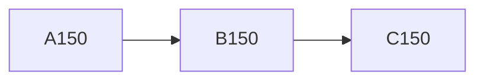

数式 $x_{150} = \sqrt{150}$

## セクション 151

これは段落 151 です。**太字**や *斜体*、`code`、[リンク](https://example.com) を含みます。

- 項目 A
- 項目 B
  - ネスト
- [ ] タスク

| 列 1 | 列 2 | 列 3 |
| --- | --- | --- |
| 151 | 302 | 453 |

## セクション 152

これは段落 152 です。**太字**や *斜体*、`code`、[リンク](https://example.com) を含みます。

- 項目 A
- 項目 B
  - ネスト
- [ ] タスク

| 列 1 | 列 2 | 列 3 |
| --- | --- | --- |
| 152 | 304 | 456 |

## セクション 153

これは段落 153 です。**太字**や *斜体*、`code`、[リンク](https://example.com) を含みます。

- 項目 A
- 項目 B
  - ネスト
- [ ] タスク

| 列 1 | 列 2 | 列 3 |
| --- | --- | --- |
| 153 | 306 | 459 |

## セクション 154

これは段落 154 です。**太字**や *斜体*、`code`、[リンク](https://example.com) を含みます。

- 項目 A
- 項目 B
  - ネスト
- [ ] タスク

| 列 1 | 列 2 | 列 3 |
| --- | --- | --- |
| 154 | 308 | 462 |

## セクション 155

これは段落 155 です。**太字**や *斜体*、`code`、[リンク](https://example.com) を含みます。

- 項目 A
- 項目 B
  - ネスト
- [ ] タスク

| 列 1 | 列 2 | 列 3 |
| --- | --- | --- |
| 155 | 310 | 465 |

## セクション 156

これは段落 156 です。**太字**や *斜体*、`code`、[リンク](https://example.com) を含みます。

- 項目 A
- 項目 B
  - ネスト
- [ ] タスク

| 列 1 | 列 2 | 列 3 |
| --- | --- | --- |
| 156 | 312 | 468 |

## セクション 157

これは段落 157 です。**太字**や *斜体*、`code`、[リンク](https://example.com) を含みます。

- 項目 A
- 項目 B
  - ネスト
- [ ] タスク

| 列 1 | 列 2 | 列 3 |
| --- | --- | --- |
| 157 | 314 | 471 |

## セクション 158

これは段落 158 です。**太字**や *斜体*、`code`、[リンク](https://example.com) を含みます。

- 項目 A
- 項目 B
  - ネスト
- [ ] タスク

| 列 1 | 列 2 | 列 3 |
| --- | --- | --- |
| 158 | 316 | 474 |

## セクション 159

これは段落 159 です。**太字**や *斜体*、`code`、[リンク](https://example.com) を含みます。

- 項目 A
- 項目 B
  - ネスト
- [ ] タスク

| 列 1 | 列 2 | 列 3 |
| --- | --- | --- |
| 159 | 318 | 477 |

## セクション 160

これは段落 160 です。**太字**や *斜体*、`code`、[リンク](https://example.com) を含みます。

- 項目 A
- 項目 B
  - ネスト
- [ ] タスク

| 列 1 | 列 2 | 列 3 |
| --- | --- | --- |
| 160 | 320 | 480 |

```js
function f160(x) {
  return x * 160
}
```

## セクション 161

これは段落 161 です。**太字**や *斜体*、`code`、[リンク](https://example.com) を含みます。

- 項目 A
- 項目 B
  - ネスト
- [ ] タスク

| 列 1 | 列 2 | 列 3 |
| --- | --- | --- |
| 161 | 322 | 483 |

## セクション 162

これは段落 162 です。**太字**や *斜体*、`code`、[リンク](https://example.com) を含みます。

- 項目 A
- 項目 B
  - ネスト
- [ ] タスク

| 列 1 | 列 2 | 列 3 |
| --- | --- | --- |
| 162 | 324 | 486 |

## セクション 163

これは段落 163 です。**太字**や *斜体*、`code`、[リンク](https://example.com) を含みます。

- 項目 A
- 項目 B
  - ネスト
- [ ] タスク

| 列 1 | 列 2 | 列 3 |
| --- | --- | --- |
| 163 | 326 | 489 |

## セクション 164

これは段落 164 です。**太字**や *斜体*、`code`、[リンク](https://example.com) を含みます。

- 項目 A
- 項目 B
  - ネスト
- [ ] タスク

| 列 1 | 列 2 | 列 3 |
| --- | --- | --- |
| 164 | 328 | 492 |

## セクション 165

これは段落 165 です。**太字**や *斜体*、`code`、[リンク](https://example.com) を含みます。

- 項目 A
- 項目 B
  - ネスト
- [ ] タスク

| 列 1 | 列 2 | 列 3 |
| --- | --- | --- |
| 165 | 330 | 495 |

数式 $x_{165} = \sqrt{165}$

## セクション 166

これは段落 166 です。**太字**や *斜体*、`code`、[リンク](https://example.com) を含みます。

- 項目 A
- 項目 B
  - ネスト
- [ ] タスク

| 列 1 | 列 2 | 列 3 |
| --- | --- | --- |
| 166 | 332 | 498 |

## セクション 167

これは段落 167 です。**太字**や *斜体*、`code`、[リンク](https://example.com) を含みます。

- 項目 A
- 項目 B
  - ネスト
- [ ] タスク

| 列 1 | 列 2 | 列 3 |
| --- | --- | --- |
| 167 | 334 | 501 |

## セクション 168

これは段落 168 です。**太字**や *斜体*、`code`、[リンク](https://example.com) を含みます。

- 項目 A
- 項目 B
  - ネスト
- [ ] タスク

| 列 1 | 列 2 | 列 3 |
| --- | --- | --- |
| 168 | 336 | 504 |

## セクション 169

これは段落 169 です。**太字**や *斜体*、`code`、[リンク](https://example.com) を含みます。

- 項目 A
- 項目 B
  - ネスト
- [ ] タスク

| 列 1 | 列 2 | 列 3 |
| --- | --- | --- |
| 169 | 338 | 507 |

## セクション 170

これは段落 170 です。**太字**や *斜体*、`code`、[リンク](https://example.com) を含みます。

- 項目 A
- 項目 B
  - ネスト
- [ ] タスク

| 列 1 | 列 2 | 列 3 |
| --- | --- | --- |
| 170 | 340 | 510 |

```js
function f170(x) {
  return x * 170
}
```

## セクション 171

これは段落 171 です。**太字**や *斜体*、`code`、[リンク](https://example.com) を含みます。

- 項目 A
- 項目 B
  - ネスト
- [ ] タスク

| 列 1 | 列 2 | 列 3 |
| --- | --- | --- |
| 171 | 342 | 513 |

## セクション 172

これは段落 172 です。**太字**や *斜体*、`code`、[リンク](https://example.com) を含みます。

- 項目 A
- 項目 B
  - ネスト
- [ ] タスク

| 列 1 | 列 2 | 列 3 |
| --- | --- | --- |
| 172 | 344 | 516 |

## セクション 173

これは段落 173 です。**太字**や *斜体*、`code`、[リンク](https://example.com) を含みます。

- 項目 A
- 項目 B
  - ネスト
- [ ] タスク

| 列 1 | 列 2 | 列 3 |
| --- | --- | --- |
| 173 | 346 | 519 |

## セクション 174

これは段落 174 です。**太字**や *斜体*、`code`、[リンク](https://example.com) を含みます。

- 項目 A
- 項目 B
  - ネスト
- [ ] タスク

| 列 1 | 列 2 | 列 3 |
| --- | --- | --- |
| 174 | 348 | 522 |

## セクション 175

これは段落 175 です。**太字**や *斜体*、`code`、[リンク](https://example.com) を含みます。

- 項目 A
- 項目 B
  - ネスト
- [ ] タスク

| 列 1 | 列 2 | 列 3 |
| --- | --- | --- |
| 175 | 350 | 525 |

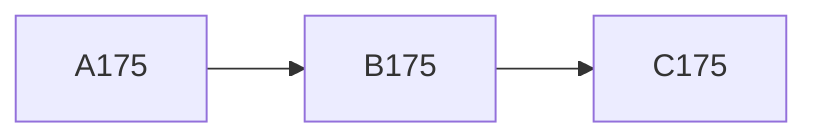

## セクション 176

これは段落 176 です。**太字**や *斜体*、`code`、[リンク](https://example.com) を含みます。

- 項目 A
- 項目 B
  - ネスト
- [ ] タスク

| 列 1 | 列 2 | 列 3 |
| --- | --- | --- |
| 176 | 352 | 528 |

## セクション 177

これは段落 177 です。**太字**や *斜体*、`code`、[リンク](https://example.com) を含みます。

- 項目 A
- 項目 B
  - ネスト
- [ ] タスク

| 列 1 | 列 2 | 列 3 |
| --- | --- | --- |
| 177 | 354 | 531 |

## セクション 178

これは段落 178 です。**太字**や *斜体*、`code`、[リンク](https://example.com) を含みます。

- 項目 A
- 項目 B
  - ネスト
- [ ] タスク

| 列 1 | 列 2 | 列 3 |
| --- | --- | --- |
| 178 | 356 | 534 |

## セクション 179

これは段落 179 です。**太字**や *斜体*、`code`、[リンク](https://example.com) を含みます。

- 項目 A
- 項目 B
  - ネスト
- [ ] タスク

| 列 1 | 列 2 | 列 3 |
| --- | --- | --- |
| 179 | 358 | 537 |

## セクション 180

これは段落 180 です。**太字**や *斜体*、`code`、[リンク](https://example.com) を含みます。

- 項目 A
- 項目 B
  - ネスト
- [ ] タスク

| 列 1 | 列 2 | 列 3 |
| --- | --- | --- |
| 180 | 360 | 540 |

```js
function f180(x) {
  return x * 180
}
```

数式 $x_{180} = \sqrt{180}$

## セクション 181

これは段落 181 です。**太字**や *斜体*、`code`、[リンク](https://example.com) を含みます。

- 項目 A
- 項目 B
  - ネスト
- [ ] タスク

| 列 1 | 列 2 | 列 3 |
| --- | --- | --- |
| 181 | 362 | 543 |

## セクション 182

これは段落 182 です。**太字**や *斜体*、`code`、[リンク](https://example.com) を含みます。

- 項目 A
- 項目 B
  - ネスト
- [ ] タスク

| 列 1 | 列 2 | 列 3 |
| --- | --- | --- |
| 182 | 364 | 546 |

## セクション 183

これは段落 183 です。**太字**や *斜体*、`code`、[リンク](https://example.com) を含みます。

- 項目 A
- 項目 B
  - ネスト
- [ ] タスク

| 列 1 | 列 2 | 列 3 |
| --- | --- | --- |
| 183 | 366 | 549 |

## セクション 184

これは段落 184 です。**太字**や *斜体*、`code`、[リンク](https://example.com) を含みます。

- 項目 A
- 項目 B
  - ネスト
- [ ] タスク

| 列 1 | 列 2 | 列 3 |
| --- | --- | --- |
| 184 | 368 | 552 |

## セクション 185

これは段落 185 です。**太字**や *斜体*、`code`、[リンク](https://example.com) を含みます。

- 項目 A
- 項目 B
  - ネスト
- [ ] タスク

| 列 1 | 列 2 | 列 3 |
| --- | --- | --- |
| 185 | 370 | 555 |

## セクション 186

これは段落 186 です。**太字**や *斜体*、`code`、[リンク](https://example.com) を含みます。

- 項目 A
- 項目 B
  - ネスト
- [ ] タスク

| 列 1 | 列 2 | 列 3 |
| --- | --- | --- |
| 186 | 372 | 558 |

## セクション 187

これは段落 187 です。**太字**や *斜体*、`code`、[リンク](https://example.com) を含みます。

- 項目 A
- 項目 B
  - ネスト
- [ ] タスク

| 列 1 | 列 2 | 列 3 |
| --- | --- | --- |
| 187 | 374 | 561 |

## セクション 188

これは段落 188 です。**太字**や *斜体*、`code`、[リンク](https://example.com) を含みます。

- 項目 A
- 項目 B
  - ネスト
- [ ] タスク

| 列 1 | 列 2 | 列 3 |
| --- | --- | --- |
| 188 | 376 | 564 |

## セクション 189

これは段落 189 です。**太字**や *斜体*、`code`、[リンク](https://example.com) を含みます。

- 項目 A
- 項目 B
  - ネスト
- [ ] タスク

| 列 1 | 列 2 | 列 3 |
| --- | --- | --- |
| 189 | 378 | 567 |

## セクション 190

これは段落 190 です。**太字**や *斜体*、`code`、[リンク](https://example.com) を含みます。

- 項目 A
- 項目 B
  - ネスト
- [ ] タスク

| 列 1 | 列 2 | 列 3 |
| --- | --- | --- |
| 190 | 380 | 570 |

```js
function f190(x) {
  return x * 190
}
```

## セクション 191

これは段落 191 です。**太字**や *斜体*、`code`、[リンク](https://example.com) を含みます。

- 項目 A
- 項目 B
  - ネスト
- [ ] タスク

| 列 1 | 列 2 | 列 3 |
| --- | --- | --- |
| 191 | 382 | 573 |

## セクション 192

これは段落 192 です。**太字**や *斜体*、`code`、[リンク](https://example.com) を含みます。

- 項目 A
- 項目 B
  - ネスト
- [ ] タスク

| 列 1 | 列 2 | 列 3 |
| --- | --- | --- |
| 192 | 384 | 576 |

## セクション 193

これは段落 193 です。**太字**や *斜体*、`code`、[リンク](https://example.com) を含みます。

- 項目 A
- 項目 B
  - ネスト
- [ ] タスク

| 列 1 | 列 2 | 列 3 |
| --- | --- | --- |
| 193 | 386 | 579 |

## セクション 194

これは段落 194 です。**太字**や *斜体*、`code`、[リンク](https://example.com) を含みます。

- 項目 A
- 項目 B
  - ネスト
- [ ] タスク

| 列 1 | 列 2 | 列 3 |
| --- | --- | --- |
| 194 | 388 | 582 |

## セクション 195

これは段落 195 です。**太字**や *斜体*、`code`、[リンク](https://example.com) を含みます。

- 項目 A
- 項目 B
  - ネスト
- [ ] タスク

| 列 1 | 列 2 | 列 3 |
| --- | --- | --- |
| 195 | 390 | 585 |

数式 $x_{195} = \sqrt{195}$

## セクション 196

これは段落 196 です。**太字**や *斜体*、`code`、[リンク](https://example.com) を含みます。

- 項目 A
- 項目 B
  - ネスト
- [ ] タスク

| 列 1 | 列 2 | 列 3 |
| --- | --- | --- |
| 196 | 392 | 588 |

## セクション 197

これは段落 197 です。**太字**や *斜体*、`code`、[リンク](https://example.com) を含みます。

- 項目 A
- 項目 B
  - ネスト
- [ ] タスク

| 列 1 | 列 2 | 列 3 |
| --- | --- | --- |
| 197 | 394 | 591 |

## セクション 198

これは段落 198 です。**太字**や *斜体*、`code`、[リンク](https://example.com) を含みます。

- 項目 A
- 項目 B
  - ネスト
- [ ] タスク

| 列 1 | 列 2 | 列 3 |
| --- | --- | --- |
| 198 | 396 | 594 |

## セクション 199

これは段落 199 です。**太字**や *斜体*、`code`、[リンク](https://example.com) を含みます。

- 項目 A
- 項目 B
  - ネスト
- [ ] タスク

| 列 1 | 列 2 | 列 3 |
| --- | --- | --- |
| 199 | 398 | 597 |

## セクション 200

これは段落 200 です。**太字**や *斜体*、`code`、[リンク](https://example.com) を含みます。

- 項目 A
- 項目 B
  - ネスト
- [ ] タスク

| 列 1 | 列 2 | 列 3 |
| --- | --- | --- |
| 200 | 400 | 600 |

```js
function f200(x) {
  return x * 200
}
```

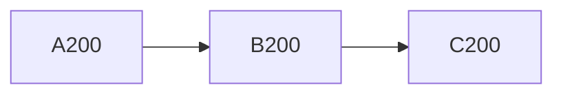

## セクション 201

これは段落 201 です。**太字**や *斜体*、`code`、[リンク](https://example.com) を含みます。

- 項目 A
- 項目 B
  - ネスト
- [ ] タスク

| 列 1 | 列 2 | 列 3 |
| --- | --- | --- |
| 201 | 402 | 603 |

## セクション 202

これは段落 202 です。**太字**や *斜体*、`code`、[リンク](https://example.com) を含みます。

- 項目 A
- 項目 B
  - ネスト
- [ ] タスク

| 列 1 | 列 2 | 列 3 |
| --- | --- | --- |
| 202 | 404 | 606 |

## セクション 203

これは段落 203 です。**太字**や *斜体*、`code`、[リンク](https://example.com) を含みます。

- 項目 A
- 項目 B
  - ネスト
- [ ] タスク

| 列 1 | 列 2 | 列 3 |
| --- | --- | --- |
| 203 | 406 | 609 |

## セクション 204

これは段落 204 です。**太字**や *斜体*、`code`、[リンク](https://example.com) を含みます。

- 項目 A
- 項目 B
  - ネスト
- [ ] タスク

| 列 1 | 列 2 | 列 3 |
| --- | --- | --- |
| 204 | 408 | 612 |

## セクション 205

これは段落 205 です。**太字**や *斜体*、`code`、[リンク](https://example.com) を含みます。

- 項目 A
- 項目 B
  - ネスト
- [ ] タスク

| 列 1 | 列 2 | 列 3 |
| --- | --- | --- |
| 205 | 410 | 615 |

## セクション 206

これは段落 206 です。**太字**や *斜体*、`code`、[リンク](https://example.com) を含みます。

- 項目 A
- 項目 B
  - ネスト
- [ ] タスク

| 列 1 | 列 2 | 列 3 |
| --- | --- | --- |
| 206 | 412 | 618 |

## セクション 207

これは段落 207 です。**太字**や *斜体*、`code`、[リンク](https://example.com) を含みます。

- 項目 A
- 項目 B
  - ネスト
- [ ] タスク

| 列 1 | 列 2 | 列 3 |
| --- | --- | --- |
| 207 | 414 | 621 |

## セクション 208

これは段落 208 です。**太字**や *斜体*、`code`、[リンク](https://example.com) を含みます。

- 項目 A
- 項目 B
  - ネスト
- [ ] タスク

| 列 1 | 列 2 | 列 3 |
| --- | --- | --- |
| 208 | 416 | 624 |

## セクション 209

これは段落 209 です。**太字**や *斜体*、`code`、[リンク](https://example.com) を含みます。

- 項目 A
- 項目 B
  - ネスト
- [ ] タスク

| 列 1 | 列 2 | 列 3 |
| --- | --- | --- |
| 209 | 418 | 627 |

## セクション 210

これは段落 210 です。**太字**や *斜体*、`code`、[リンク](https://example.com) を含みます。

- 項目 A
- 項目 B
  - ネスト
- [ ] タスク

| 列 1 | 列 2 | 列 3 |
| --- | --- | --- |
| 210 | 420 | 630 |

```js
function f210(x) {
  return x * 210
}
```

数式 $x_{210} = \sqrt{210}$

## セクション 211

これは段落 211 です。**太字**や *斜体*、`code`、[リンク](https://example.com) を含みます。

- 項目 A
- 項目 B
  - ネスト
- [ ] タスク

| 列 1 | 列 2 | 列 3 |
| --- | --- | --- |
| 211 | 422 | 633 |

## セクション 212

これは段落 212 です。**太字**や *斜体*、`code`、[リンク](https://example.com) を含みます。

- 項目 A
- 項目 B
  - ネスト
- [ ] タスク

| 列 1 | 列 2 | 列 3 |
| --- | --- | --- |
| 212 | 424 | 636 |

## セクション 213

これは段落 213 です。**太字**や *斜体*、`code`、[リンク](https://example.com) を含みます。

- 項目 A
- 項目 B
  - ネスト
- [ ] タスク

| 列 1 | 列 2 | 列 3 |
| --- | --- | --- |
| 213 | 426 | 639 |

## セクション 214

これは段落 214 です。**太字**や *斜体*、`code`、[リンク](https://example.com) を含みます。

- 項目 A
- 項目 B
  - ネスト
- [ ] タスク

| 列 1 | 列 2 | 列 3 |
| --- | --- | --- |
| 214 | 428 | 642 |

## セクション 215

これは段落 215 です。**太字**や *斜体*、`code`、[リンク](https://example.com) を含みます。

- 項目 A
- 項目 B
  - ネスト
- [ ] タスク

| 列 1 | 列 2 | 列 3 |
| --- | --- | --- |
| 215 | 430 | 645 |

## セクション 216

これは段落 216 です。**太字**や *斜体*、`code`、[リンク](https://example.com) を含みます。

- 項目 A
- 項目 B
  - ネスト
- [ ] タスク

| 列 1 | 列 2 | 列 3 |
| --- | --- | --- |
| 216 | 432 | 648 |

## セクション 217

これは段落 217 です。**太字**や *斜体*、`code`、[リンク](https://example.com) を含みます。

- 項目 A
- 項目 B
  - ネスト
- [ ] タスク

| 列 1 | 列 2 | 列 3 |
| --- | --- | --- |
| 217 | 434 | 651 |

## セクション 218

これは段落 218 です。**太字**や *斜体*、`code`、[リンク](https://example.com) を含みます。

- 項目 A
- 項目 B
  - ネスト
- [ ] タスク

| 列 1 | 列 2 | 列 3 |
| --- | --- | --- |
| 218 | 436 | 654 |

## セクション 219

これは段落 219 です。**太字**や *斜体*、`code`、[リンク](https://example.com) を含みます。

- 項目 A
- 項目 B
  - ネスト
- [ ] タスク

| 列 1 | 列 2 | 列 3 |
| --- | --- | --- |
| 219 | 438 | 657 |

## セクション 220

これは段落 220 です。**太字**や *斜体*、`code`、[リンク](https://example.com) を含みます。

- 項目 A
- 項目 B
  - ネスト
- [ ] タスク

| 列 1 | 列 2 | 列 3 |
| --- | --- | --- |
| 220 | 440 | 660 |

```js
function f220(x) {
  return x * 220
}
```

## セクション 221

これは段落 221 です。**太字**や *斜体*、`code`、[リンク](https://example.com) を含みます。

- 項目 A
- 項目 B
  - ネスト
- [ ] タスク

| 列 1 | 列 2 | 列 3 |
| --- | --- | --- |
| 221 | 442 | 663 |

## セクション 222

これは段落 222 です。**太字**や *斜体*、`code`、[リンク](https://example.com) を含みます。

- 項目 A
- 項目 B
  - ネスト
- [ ] タスク

| 列 1 | 列 2 | 列 3 |
| --- | --- | --- |
| 222 | 444 | 666 |

## セクション 223

これは段落 223 です。**太字**や *斜体*、`code`、[リンク](https://example.com) を含みます。

- 項目 A
- 項目 B
  - ネスト
- [ ] タスク

| 列 1 | 列 2 | 列 3 |
| --- | --- | --- |
| 223 | 446 | 669 |

## セクション 224

これは段落 224 です。**太字**や *斜体*、`code`、[リンク](https://example.com) を含みます。

- 項目 A
- 項目 B
  - ネスト
- [ ] タスク

| 列 1 | 列 2 | 列 3 |
| --- | --- | --- |
| 224 | 448 | 672 |

## セクション 225

これは段落 225 です。**太字**や *斜体*、`code`、[リンク](https://example.com) を含みます。

- 項目 A
- 項目 B
  - ネスト
- [ ] タスク

| 列 1 | 列 2 | 列 3 |
| --- | --- | --- |
| 225 | 450 | 675 |

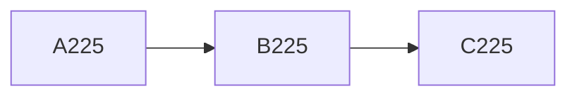

数式 $x_{225} = \sqrt{225}$

## セクション 226

これは段落 226 です。**太字**や *斜体*、`code`、[リンク](https://example.com) を含みます。

- 項目 A
- 項目 B
  - ネスト
- [ ] タスク

| 列 1 | 列 2 | 列 3 |
| --- | --- | --- |
| 226 | 452 | 678 |

## セクション 227

これは段落 227 です。**太字**や *斜体*、`code`、[リンク](https://example.com) を含みます。

- 項目 A
- 項目 B
  - ネスト
- [ ] タスク

| 列 1 | 列 2 | 列 3 |
| --- | --- | --- |
| 227 | 454 | 681 |

## セクション 228

これは段落 228 です。**太字**や *斜体*、`code`、[リンク](https://example.com) を含みます。

- 項目 A
- 項目 B
  - ネスト
- [ ] タスク

| 列 1 | 列 2 | 列 3 |
| --- | --- | --- |
| 228 | 456 | 684 |

## セクション 229

これは段落 229 です。**太字**や *斜体*、`code`、[リンク](https://example.com) を含みます。

- 項目 A
- 項目 B
  - ネスト
- [ ] タスク

| 列 1 | 列 2 | 列 3 |
| --- | --- | --- |
| 229 | 458 | 687 |

## セクション 230

これは段落 230 です。**太字**や *斜体*、`code`、[リンク](https://example.com) を含みます。

- 項目 A
- 項目 B
  - ネスト
- [ ] タスク

| 列 1 | 列 2 | 列 3 |
| --- | --- | --- |
| 230 | 460 | 690 |

```js
function f230(x) {
  return x * 230
}
```

## セクション 231

これは段落 231 です。**太字**や *斜体*、`code`、[リンク](https://example.com) を含みます。

- 項目 A
- 項目 B
  - ネスト
- [ ] タスク

| 列 1 | 列 2 | 列 3 |
| --- | --- | --- |
| 231 | 462 | 693 |

## セクション 232

これは段落 232 です。**太字**や *斜体*、`code`、[リンク](https://example.com) を含みます。

- 項目 A
- 項目 B
  - ネスト
- [ ] タスク

| 列 1 | 列 2 | 列 3 |
| --- | --- | --- |
| 232 | 464 | 696 |

## セクション 233

これは段落 233 です。**太字**や *斜体*、`code`、[リンク](https://example.com) を含みます。

- 項目 A
- 項目 B
  - ネスト
- [ ] タスク

| 列 1 | 列 2 | 列 3 |
| --- | --- | --- |
| 233 | 466 | 699 |

## セクション 234

これは段落 234 です。**太字**や *斜体*、`code`、[リンク](https://example.com) を含みます。

- 項目 A
- 項目 B
  - ネスト
- [ ] タスク

| 列 1 | 列 2 | 列 3 |
| --- | --- | --- |
| 234 | 468 | 702 |

## セクション 235

これは段落 235 です。**太字**や *斜体*、`code`、[リンク](https://example.com) を含みます。

- 項目 A
- 項目 B
  - ネスト
- [ ] タスク

| 列 1 | 列 2 | 列 3 |
| --- | --- | --- |
| 235 | 470 | 705 |

## セクション 236

これは段落 236 です。**太字**や *斜体*、`code`、[リンク](https://example.com) を含みます。

- 項目 A
- 項目 B
  - ネスト
- [ ] タスク

| 列 1 | 列 2 | 列 3 |
| --- | --- | --- |
| 236 | 472 | 708 |

## セクション 237

これは段落 237 です。**太字**や *斜体*、`code`、[リンク](https://example.com) を含みます。

- 項目 A
- 項目 B
  - ネスト
- [ ] タスク

| 列 1 | 列 2 | 列 3 |
| --- | --- | --- |
| 237 | 474 | 711 |

## セクション 238

これは段落 238 です。**太字**や *斜体*、`code`、[リンク](https://example.com) を含みます。

- 項目 A
- 項目 B
  - ネスト
- [ ] タスク

| 列 1 | 列 2 | 列 3 |
| --- | --- | --- |
| 238 | 476 | 714 |

## セクション 239

これは段落 239 です。**太字**や *斜体*、`code`、[リンク](https://example.com) を含みます。

- 項目 A
- 項目 B
  - ネスト
- [ ] タスク

| 列 1 | 列 2 | 列 3 |
| --- | --- | --- |
| 239 | 478 | 717 |

## セクション 240

これは段落 240 です。**太字**や *斜体*、`code`、[リンク](https://example.com) を含みます。

- 項目 A
- 項目 B
  - ネスト
- [ ] タスク

| 列 1 | 列 2 | 列 3 |
| --- | --- | --- |
| 240 | 480 | 720 |

```js
function f240(x) {
  return x * 240
}
```

数式 $x_{240} = \sqrt{240}$

## セクション 241

これは段落 241 です。**太字**や *斜体*、`code`、[リンク](https://example.com) を含みます。

- 項目 A
- 項目 B
  - ネスト
- [ ] タスク

| 列 1 | 列 2 | 列 3 |
| --- | --- | --- |
| 241 | 482 | 723 |

## セクション 242

これは段落 242 です。**太字**や *斜体*、`code`、[リンク](https://example.com) を含みます。

- 項目 A
- 項目 B
  - ネスト
- [ ] タスク

| 列 1 | 列 2 | 列 3 |
| --- | --- | --- |
| 242 | 484 | 726 |

## セクション 243

これは段落 243 です。**太字**や *斜体*、`code`、[リンク](https://example.com) を含みます。

- 項目 A
- 項目 B
  - ネスト
- [ ] タスク

| 列 1 | 列 2 | 列 3 |
| --- | --- | --- |
| 243 | 486 | 729 |

## セクション 244

これは段落 244 です。**太字**や *斜体*、`code`、[リンク](https://example.com) を含みます。

- 項目 A
- 項目 B
  - ネスト
- [ ] タスク

| 列 1 | 列 2 | 列 3 |
| --- | --- | --- |
| 244 | 488 | 732 |

## セクション 245

これは段落 245 です。**太字**や *斜体*、`code`、[リンク](https://example.com) を含みます。

- 項目 A
- 項目 B
  - ネスト
- [ ] タスク

| 列 1 | 列 2 | 列 3 |
| --- | --- | --- |
| 245 | 490 | 735 |

## セクション 246

これは段落 246 です。**太字**や *斜体*、`code`、[リンク](https://example.com) を含みます。

- 項目 A
- 項目 B
  - ネスト
- [ ] タスク

| 列 1 | 列 2 | 列 3 |
| --- | --- | --- |
| 246 | 492 | 738 |

## セクション 247

これは段落 247 です。**太字**や *斜体*、`code`、[リンク](https://example.com) を含みます。

- 項目 A
- 項目 B
  - ネスト
- [ ] タスク

| 列 1 | 列 2 | 列 3 |
| --- | --- | --- |
| 247 | 494 | 741 |

## セクション 248

これは段落 248 です。**太字**や *斜体*、`code`、[リンク](https://example.com) を含みます。

- 項目 A
- 項目 B
  - ネスト
- [ ] タスク

| 列 1 | 列 2 | 列 3 |
| --- | --- | --- |
| 248 | 496 | 744 |

## セクション 249

これは段落 249 です。**太字**や *斜体*、`code`、[リンク](https://example.com) を含みます。

- 項目 A
- 項目 B
  - ネスト
- [ ] タスク

| 列 1 | 列 2 | 列 3 |
| --- | --- | --- |
| 249 | 498 | 747 |

## セクション 250

これは段落 250 です。**太字**や *斜体*、`code`、[リンク](https://example.com) を含みます。

- 項目 A
- 項目 B
  - ネスト
- [ ] タスク

| 列 1 | 列 2 | 列 3 |
| --- | --- | --- |
| 250 | 500 | 750 |

```js
function f250(x) {
  return x * 250
}
```

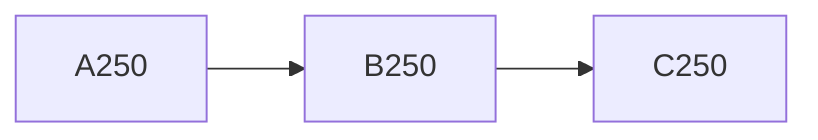

## セクション 251

これは段落 251 です。**太字**や *斜体*、`code`、[リンク](https://example.com) を含みます。

- 項目 A
- 項目 B
  - ネスト
- [ ] タスク

| 列 1 | 列 2 | 列 3 |
| --- | --- | --- |
| 251 | 502 | 753 |

## セクション 252

これは段落 252 です。**太字**や *斜体*、`code`、[リンク](https://example.com) を含みます。

- 項目 A
- 項目 B
  - ネスト
- [ ] タスク

| 列 1 | 列 2 | 列 3 |
| --- | --- | --- |
| 252 | 504 | 756 |

## セクション 253

これは段落 253 です。**太字**や *斜体*、`code`、[リンク](https://example.com) を含みます。

- 項目 A
- 項目 B
  - ネスト
- [ ] タスク

| 列 1 | 列 2 | 列 3 |
| --- | --- | --- |
| 253 | 506 | 759 |

## セクション 254

これは段落 254 です。**太字**や *斜体*、`code`、[リンク](https://example.com) を含みます。

- 項目 A
- 項目 B
  - ネスト
- [ ] タスク

| 列 1 | 列 2 | 列 3 |
| --- | --- | --- |
| 254 | 508 | 762 |

## セクション 255

これは段落 255 です。**太字**や *斜体*、`code`、[リンク](https://example.com) を含みます。

- 項目 A
- 項目 B
  - ネスト
- [ ] タスク

| 列 1 | 列 2 | 列 3 |
| --- | --- | --- |
| 255 | 510 | 765 |

数式 $x_{255} = \sqrt{255}$

## セクション 256

これは段落 256 です。**太字**や *斜体*、`code`、[リンク](https://example.com) を含みます。

- 項目 A
- 項目 B
  - ネスト
- [ ] タスク

| 列 1 | 列 2 | 列 3 |
| --- | --- | --- |
| 256 | 512 | 768 |

## セクション 257

これは段落 257 です。**太字**や *斜体*、`code`、[リンク](https://example.com) を含みます。

- 項目 A
- 項目 B
  - ネスト
- [ ] タスク

| 列 1 | 列 2 | 列 3 |
| --- | --- | --- |
| 257 | 514 | 771 |

## セクション 258

これは段落 258 です。**太字**や *斜体*、`code`、[リンク](https://example.com) を含みます。

- 項目 A
- 項目 B
  - ネスト
- [ ] タスク

| 列 1 | 列 2 | 列 3 |
| --- | --- | --- |
| 258 | 516 | 774 |

## セクション 259

これは段落 259 です。**太字**や *斜体*、`code`、[リンク](https://example.com) を含みます。

- 項目 A
- 項目 B
  - ネスト
- [ ] タスク

| 列 1 | 列 2 | 列 3 |
| --- | --- | --- |
| 259 | 518 | 777 |

## セクション 260

これは段落 260 です。**太字**や *斜体*、`code`、[リンク](https://example.com) を含みます。

- 項目 A
- 項目 B
  - ネスト
- [ ] タスク

| 列 1 | 列 2 | 列 3 |
| --- | --- | --- |
| 260 | 520 | 780 |

```js
function f260(x) {
  return x * 260
}
```

## セクション 261

これは段落 261 です。**太字**や *斜体*、`code`、[リンク](https://example.com) を含みます。

- 項目 A
- 項目 B
  - ネスト
- [ ] タスク

| 列 1 | 列 2 | 列 3 |
| --- | --- | --- |
| 261 | 522 | 783 |

## セクション 262

これは段落 262 です。**太字**や *斜体*、`code`、[リンク](https://example.com) を含みます。

- 項目 A
- 項目 B
  - ネスト
- [ ] タスク

| 列 1 | 列 2 | 列 3 |
| --- | --- | --- |
| 262 | 524 | 786 |

## セクション 263

これは段落 263 です。**太字**や *斜体*、`code`、[リンク](https://example.com) を含みます。

- 項目 A
- 項目 B
  - ネスト
- [ ] タスク

| 列 1 | 列 2 | 列 3 |
| --- | --- | --- |
| 263 | 526 | 789 |

## セクション 264

これは段落 264 です。**太字**や *斜体*、`code`、[リンク](https://example.com) を含みます。

- 項目 A
- 項目 B
  - ネスト
- [ ] タスク

| 列 1 | 列 2 | 列 3 |
| --- | --- | --- |
| 264 | 528 | 792 |

## セクション 265

これは段落 265 です。**太字**や *斜体*、`code`、[リンク](https://example.com) を含みます。

- 項目 A
- 項目 B
  - ネスト
- [ ] タスク

| 列 1 | 列 2 | 列 3 |
| --- | --- | --- |
| 265 | 530 | 795 |

## セクション 266

これは段落 266 です。**太字**や *斜体*、`code`、[リンク](https://example.com) を含みます。

- 項目 A
- 項目 B
  - ネスト
- [ ] タスク

| 列 1 | 列 2 | 列 3 |
| --- | --- | --- |
| 266 | 532 | 798 |

## セクション 267

これは段落 267 です。**太字**や *斜体*、`code`、[リンク](https://example.com) を含みます。

- 項目 A
- 項目 B
  - ネスト
- [ ] タスク

| 列 1 | 列 2 | 列 3 |
| --- | --- | --- |
| 267 | 534 | 801 |

## セクション 268

これは段落 268 です。**太字**や *斜体*、`code`、[リンク](https://example.com) を含みます。

- 項目 A
- 項目 B
  - ネスト
- [ ] タスク

| 列 1 | 列 2 | 列 3 |
| --- | --- | --- |
| 268 | 536 | 804 |

## セクション 269

これは段落 269 です。**太字**や *斜体*、`code`、[リンク](https://example.com) を含みます。

- 項目 A
- 項目 B
  - ネスト
- [ ] タスク

| 列 1 | 列 2 | 列 3 |
| --- | --- | --- |
| 269 | 538 | 807 |

## セクション 270

これは段落 270 です。**太字**や *斜体*、`code`、[リンク](https://example.com) を含みます。

- 項目 A
- 項目 B
  - ネスト
- [ ] タスク

| 列 1 | 列 2 | 列 3 |
| --- | --- | --- |
| 270 | 540 | 810 |

```js
function f270(x) {
  return x * 270
}
```

数式 $x_{270} = \sqrt{270}$

## セクション 271

これは段落 271 です。**太字**や *斜体*、`code`、[リンク](https://example.com) を含みます。

- 項目 A
- 項目 B
  - ネスト
- [ ] タスク

| 列 1 | 列 2 | 列 3 |
| --- | --- | --- |
| 271 | 542 | 813 |

## セクション 272

これは段落 272 です。**太字**や *斜体*、`code`、[リンク](https://example.com) を含みます。

- 項目 A
- 項目 B
  - ネスト
- [ ] タスク

| 列 1 | 列 2 | 列 3 |
| --- | --- | --- |
| 272 | 544 | 816 |

## セクション 273

これは段落 273 です。**太字**や *斜体*、`code`、[リンク](https://example.com) を含みます。

- 項目 A
- 項目 B
  - ネスト
- [ ] タスク

| 列 1 | 列 2 | 列 3 |
| --- | --- | --- |
| 273 | 546 | 819 |

## セクション 274

これは段落 274 です。**太字**や *斜体*、`code`、[リンク](https://example.com) を含みます。

- 項目 A
- 項目 B
  - ネスト
- [ ] タスク

| 列 1 | 列 2 | 列 3 |
| --- | --- | --- |
| 274 | 548 | 822 |

## セクション 275

これは段落 275 です。**太字**や *斜体*、`code`、[リンク](https://example.com) を含みます。

- 項目 A
- 項目 B
  - ネスト
- [ ] タスク

| 列 1 | 列 2 | 列 3 |
| --- | --- | --- |
| 275 | 550 | 825 |


## セクション 276

これは段落 276 です。**太字**や *斜体*、`code`、[リンク](https://example.com) を含みます。

- 項目 A
- 項目 B
  - ネスト
- [ ] タスク

| 列 1 | 列 2 | 列 3 |
| --- | --- | --- |
| 276 | 552 | 828 |

## セクション 277

これは段落 277 です。**太字**や *斜体*、`code`、[リンク](https://example.com) を含みます。

- 項目 A
- 項目 B
  - ネスト
- [ ] タスク

| 列 1 | 列 2 | 列 3 |
| --- | --- | --- |
| 277 | 554 | 831 |

## セクション 278

これは段落 278 です。**太字**や *斜体*、`code`、[リンク](https://example.com) を含みます。

- 項目 A
- 項目 B
  - ネスト
- [ ] タスク

| 列 1 | 列 2 | 列 3 |
| --- | --- | --- |
| 278 | 556 | 834 |

## セクション 279

これは段落 279 です。**太字**や *斜体*、`code`、[リンク](https://example.com) を含みます。

- 項目 A
- 項目 B
  - ネスト
- [ ] タスク

| 列 1 | 列 2 | 列 3 |
| --- | --- | --- |
| 279 | 558 | 837 |

## セクション 280

これは段落 280 です。**太字**や *斜体*、`code`、[リンク](https://example.com) を含みます。

- 項目 A
- 項目 B
  - ネスト
- [ ] タスク

| 列 1 | 列 2 | 列 3 |
| --- | --- | --- |
| 280 | 560 | 840 |

```js
function f280(x) {
  return x * 280
}
```

## セクション 281

これは段落 281 です。**太字**や *斜体*、`code`、[リンク](https://example.com) を含みます。

- 項目 A
- 項目 B
  - ネスト
- [ ] タスク

| 列 1 | 列 2 | 列 3 |
| --- | --- | --- |
| 281 | 562 | 843 |

## セクション 282

これは段落 282 です。**太字**や *斜体*、`code`、[リンク](https://example.com) を含みます。

- 項目 A
- 項目 B
  - ネスト
- [ ] タスク

| 列 1 | 列 2 | 列 3 |
| --- | --- | --- |
| 282 | 564 | 846 |

## セクション 283

これは段落 283 です。**太字**や *斜体*、`code`、[リンク](https://example.com) を含みます。

- 項目 A
- 項目 B
  - ネスト
- [ ] タスク

| 列 1 | 列 2 | 列 3 |
| --- | --- | --- |
| 283 | 566 | 849 |

## セクション 284

これは段落 284 です。**太字**や *斜体*、`code`、[リンク](https://example.com) を含みます。

- 項目 A
- 項目 B
  - ネスト
- [ ] タスク

| 列 1 | 列 2 | 列 3 |
| --- | --- | --- |
| 284 | 568 | 852 |

## セクション 285

これは段落 285 です。**太字**や *斜体*、`code`、[リンク](https://example.com) を含みます。

- 項目 A
- 項目 B
  - ネスト
- [ ] タスク

| 列 1 | 列 2 | 列 3 |
| --- | --- | --- |
| 285 | 570 | 855 |

数式 $x_{285} = \sqrt{285}$

## セクション 286

これは段落 286 です。**太字**や *斜体*、`code`、[リンク](https://example.com) を含みます。

- 項目 A
- 項目 B
  - ネスト
- [ ] タスク

| 列 1 | 列 2 | 列 3 |
| --- | --- | --- |
| 286 | 572 | 858 |

## セクション 287

これは段落 287 です。**太字**や *斜体*、`code`、[リンク](https://example.com) を含みます。

- 項目 A
- 項目 B
  - ネスト
- [ ] タスク

| 列 1 | 列 2 | 列 3 |
| --- | --- | --- |
| 287 | 574 | 861 |

## セクション 288

これは段落 288 です。**太字**や *斜体*、`code`、[リンク](https://example.com) を含みます。

- 項目 A
- 項目 B
  - ネスト
- [ ] タスク

| 列 1 | 列 2 | 列 3 |
| --- | --- | --- |
| 288 | 576 | 864 |

## セクション 289

これは段落 289 です。**太字**や *斜体*、`code`、[リンク](https://example.com) を含みます。

- 項目 A
- 項目 B
  - ネスト
- [ ] タスク

| 列 1 | 列 2 | 列 3 |
| --- | --- | --- |
| 289 | 578 | 867 |

## セクション 290

これは段落 290 です。**太字**や *斜体*、`code`、[リンク](https://example.com) を含みます。

- 項目 A
- 項目 B
  - ネスト
- [ ] タスク

| 列 1 | 列 2 | 列 3 |
| --- | --- | --- |
| 290 | 580 | 870 |

```js
function f290(x) {
  return x * 290
}
```

## セクション 291

これは段落 291 です。**太字**や *斜体*、`code`、[リンク](https://example.com) を含みます。

- 項目 A
- 項目 B
  - ネスト
- [ ] タスク

| 列 1 | 列 2 | 列 3 |
| --- | --- | --- |
| 291 | 582 | 873 |

## セクション 292

これは段落 292 です。**太字**や *斜体*、`code`、[リンク](https://example.com) を含みます。

- 項目 A
- 項目 B
  - ネスト
- [ ] タスク

| 列 1 | 列 2 | 列 3 |
| --- | --- | --- |
| 292 | 584 | 876 |

## セクション 293

これは段落 293 です。**太字**や *斜体*、`code`、[リンク](https://example.com) を含みます。

- 項目 A
- 項目 B
  - ネスト
- [ ] タスク

| 列 1 | 列 2 | 列 3 |
| --- | --- | --- |
| 293 | 586 | 879 |

## セクション 294

これは段落 294 です。**太字**や *斜体*、`code`、[リンク](https://example.com) を含みます。

- 項目 A
- 項目 B
  - ネスト
- [ ] タスク

| 列 1 | 列 2 | 列 3 |
| --- | --- | --- |
| 294 | 588 | 882 |

## セクション 295

これは段落 295 です。**太字**や *斜体*、`code`、[リンク](https://example.com) を含みます。

- 項目 A
- 項目 B
  - ネスト
- [ ] タスク

| 列 1 | 列 2 | 列 3 |
| --- | --- | --- |
| 295 | 590 | 885 |

## セクション 296

これは段落 296 です。**太字**や *斜体*、`code`、[リンク](https://example.com) を含みます。

- 項目 A
- 項目 B
  - ネスト
- [ ] タスク

| 列 1 | 列 2 | 列 3 |
| --- | --- | --- |
| 296 | 592 | 888 |

## セクション 297

これは段落 297 です。**太字**や *斜体*、`code`、[リンク](https://example.com) を含みます。

- 項目 A
- 項目 B
  - ネスト
- [ ] タスク

| 列 1 | 列 2 | 列 3 |
| --- | --- | --- |
| 297 | 594 | 891 |

## セクション 298

これは段落 298 です。**太字**や *斜体*、`code`、[リンク](https://example.com) を含みます。

- 項目 A
- 項目 B
  - ネスト
- [ ] タスク

| 列 1 | 列 2 | 列 3 |
| --- | --- | --- |
| 298 | 596 | 894 |

## セクション 299

これは段落 299 です。**太字**や *斜体*、`code`、[リンク](https://example.com) を含みます。

- 項目 A
- 項目 B
  - ネスト
- [ ] タスク

| 列 1 | 列 2 | 列 3 |
| --- | --- | --- |
| 299 | 598 | 897 |

## セクション 300

これは段落 300 です。**太字**や *斜体*、`code`、[リンク](https://example.com) を含みます。

- 項目 A
- 項目 B
  - ネスト
- [ ] タスク

| 列 1 | 列 2 | 列 3 |
| --- | --- | --- |
| 300 | 600 | 900 |

```js
function f300(x) {
  return x * 300
}
```

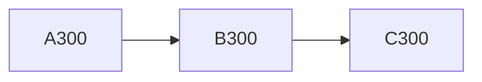

数式 $x_{300} = \sqrt{300}$

## セクション 301

これは段落 301 です。**太字**や *斜体*、`code`、[リンク](https://example.com) を含みます。

- 項目 A
- 項目 B
  - ネスト
- [ ] タスク

| 列 1 | 列 2 | 列 3 |
| --- | --- | --- |
| 301 | 602 | 903 |

## セクション 302

これは段落 302 です。**太字**や *斜体*、`code`、[リンク](https://example.com) を含みます。

- 項目 A
- 項目 B
  - ネスト
- [ ] タスク

| 列 1 | 列 2 | 列 3 |
| --- | --- | --- |
| 302 | 604 | 906 |

## セクション 303

これは段落 303 です。**太字**や *斜体*、`code`、[リンク](https://example.com) を含みます。

- 項目 A
- 項目 B
  - ネスト
- [ ] タスク

| 列 1 | 列 2 | 列 3 |
| --- | --- | --- |
| 303 | 606 | 909 |

## セクション 304

これは段落 304 です。**太字**や *斜体*、`code`、[リンク](https://example.com) を含みます。

- 項目 A
- 項目 B
  - ネスト
- [ ] タスク

| 列 1 | 列 2 | 列 3 |
| --- | --- | --- |
| 304 | 608 | 912 |

## セクション 305

これは段落 305 です。**太字**や *斜体*、`code`、[リンク](https://example.com) を含みます。

- 項目 A
- 項目 B
  - ネスト
- [ ] タスク

| 列 1 | 列 2 | 列 3 |
| --- | --- | --- |
| 305 | 610 | 915 |

## セクション 306

これは段落 306 です。**太字**や *斜体*、`code`、[リンク](https://example.com) を含みます。

- 項目 A
- 項目 B
  - ネスト
- [ ] タスク

| 列 1 | 列 2 | 列 3 |
| --- | --- | --- |
| 306 | 612 | 918 |

## セクション 307

これは段落 307 です。**太字**や *斜体*、`code`、[リンク](https://example.com) を含みます。

- 項目 A
- 項目 B
  - ネスト
- [ ] タスク

| 列 1 | 列 2 | 列 3 |
| --- | --- | --- |
| 307 | 614 | 921 |

## セクション 308

これは段落 308 です。**太字**や *斜体*、`code`、[リンク](https://example.com) を含みます。

- 項目 A
- 項目 B
  - ネスト
- [ ] タスク

| 列 1 | 列 2 | 列 3 |
| --- | --- | --- |
| 308 | 616 | 924 |

## セクション 309

これは段落 309 です。**太字**や *斜体*、`code`、[リンク](https://example.com) を含みます。

- 項目 A
- 項目 B
  - ネスト
- [ ] タスク

| 列 1 | 列 2 | 列 3 |
| --- | --- | --- |
| 309 | 618 | 927 |

## セクション 310

これは段落 310 です。**太字**や *斜体*、`code`、[リンク](https://example.com) を含みます。

- 項目 A
- 項目 B
  - ネスト
- [ ] タスク

| 列 1 | 列 2 | 列 3 |
| --- | --- | --- |
| 310 | 620 | 930 |

```js
function f310(x) {
  return x * 310
}
```

## セクション 311

これは段落 311 です。**太字**や *斜体*、`code`、[リンク](https://example.com) を含みます。

- 項目 A
- 項目 B
  - ネスト
- [ ] タスク

| 列 1 | 列 2 | 列 3 |
| --- | --- | --- |
| 311 | 622 | 933 |

## セクション 312

これは段落 312 です。**太字**や *斜体*、`code`、[リンク](https://example.com) を含みます。

- 項目 A
- 項目 B
  - ネスト
- [ ] タスク

| 列 1 | 列 2 | 列 3 |
| --- | --- | --- |
| 312 | 624 | 936 |

## セクション 313

これは段落 313 です。**太字**や *斜体*、`code`、[リンク](https://example.com) を含みます。

- 項目 A
- 項目 B
  - ネスト
- [ ] タスク

| 列 1 | 列 2 | 列 3 |
| --- | --- | --- |
| 313 | 626 | 939 |

## セクション 314

これは段落 314 です。**太字**や *斜体*、`code`、[リンク](https://example.com) を含みます。

- 項目 A
- 項目 B
  - ネスト
- [ ] タスク

| 列 1 | 列 2 | 列 3 |
| --- | --- | --- |
| 314 | 628 | 942 |

## セクション 315

これは段落 315 です。**太字**や *斜体*、`code`、[リンク](https://example.com) を含みます。

- 項目 A
- 項目 B
  - ネスト
- [ ] タスク

| 列 1 | 列 2 | 列 3 |
| --- | --- | --- |
| 315 | 630 | 945 |

数式 $x_{315} = \sqrt{315}$

## セクション 316

これは段落 316 です。**太字**や *斜体*、`code`、[リンク](https://example.com) を含みます。

- 項目 A
- 項目 B
  - ネスト
- [ ] タスク

| 列 1 | 列 2 | 列 3 |
| --- | --- | --- |
| 316 | 632 | 948 |

## セクション 317

これは段落 317 です。**太字**や *斜体*、`code`、[リンク](https://example.com) を含みます。

- 項目 A
- 項目 B
  - ネスト
- [ ] タスク

| 列 1 | 列 2 | 列 3 |
| --- | --- | --- |
| 317 | 634 | 951 |

## セクション 318

これは段落 318 です。**太字**や *斜体*、`code`、[リンク](https://example.com) を含みます。

- 項目 A
- 項目 B
  - ネスト
- [ ] タスク

| 列 1 | 列 2 | 列 3 |
| --- | --- | --- |
| 318 | 636 | 954 |

## セクション 319

これは段落 319 です。**太字**や *斜体*、`code`、[リンク](https://example.com) を含みます。

- 項目 A
- 項目 B
  - ネスト
- [ ] タスク

| 列 1 | 列 2 | 列 3 |
| --- | --- | --- |
| 319 | 638 | 957 |

## セクション 320

これは段落 320 です。**太字**や *斜体*、`code`、[リンク](https://example.com) を含みます。

- 項目 A
- 項目 B
  - ネスト
- [ ] タスク

| 列 1 | 列 2 | 列 3 |
| --- | --- | --- |
| 320 | 640 | 960 |

```js
function f320(x) {
  return x * 320
}
```

## セクション 321

これは段落 321 です。**太字**や *斜体*、`code`、[リンク](https://example.com) を含みます。

- 項目 A
- 項目 B
  - ネスト
- [ ] タスク

| 列 1 | 列 2 | 列 3 |
| --- | --- | --- |
| 321 | 642 | 963 |

## セクション 322

これは段落 322 です。**太字**や *斜体*、`code`、[リンク](https://example.com) を含みます。

- 項目 A
- 項目 B
  - ネスト
- [ ] タスク

| 列 1 | 列 2 | 列 3 |
| --- | --- | --- |
| 322 | 644 | 966 |

## セクション 323

これは段落 323 です。**太字**や *斜体*、`code`、[リンク](https://example.com) を含みます。

- 項目 A
- 項目 B
  - ネスト
- [ ] タスク

| 列 1 | 列 2 | 列 3 |
| --- | --- | --- |
| 323 | 646 | 969 |

## セクション 324

これは段落 324 です。**太字**や *斜体*、`code`、[リンク](https://example.com) を含みます。

- 項目 A
- 項目 B
  - ネスト
- [ ] タスク

| 列 1 | 列 2 | 列 3 |
| --- | --- | --- |
| 324 | 648 | 972 |

## セクション 325

これは段落 325 です。**太字**や *斜体*、`code`、[リンク](https://example.com) を含みます。

- 項目 A
- 項目 B
  - ネスト
- [ ] タスク

| 列 1 | 列 2 | 列 3 |
| --- | --- | --- |
| 325 | 650 | 975 |

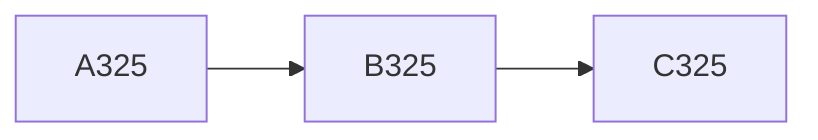

## セクション 326

これは段落 326 です。**太字**や *斜体*、`code`、[リンク](https://example.com) を含みます。

- 項目 A
- 項目 B
  - ネスト
- [ ] タスク

| 列 1 | 列 2 | 列 3 |
| --- | --- | --- |
| 326 | 652 | 978 |

## セクション 327

これは段落 327 です。**太字**や *斜体*、`code`、[リンク](https://example.com) を含みます。

- 項目 A
- 項目 B
  - ネスト
- [ ] タスク

| 列 1 | 列 2 | 列 3 |
| --- | --- | --- |
| 327 | 654 | 981 |

## セクション 328

これは段落 328 です。**太字**や *斜体*、`code`、[リンク](https://example.com) を含みます。

- 項目 A
- 項目 B
  - ネスト
- [ ] タスク

| 列 1 | 列 2 | 列 3 |
| --- | --- | --- |
| 328 | 656 | 984 |

## セクション 329

これは段落 329 です。**太字**や *斜体*、`code`、[リンク](https://example.com) を含みます。

- 項目 A
- 項目 B
  - ネスト
- [ ] タスク

| 列 1 | 列 2 | 列 3 |
| --- | --- | --- |
| 329 | 658 | 987 |

## セクション 330

これは段落 330 です。**太字**や *斜体*、`code`、[リンク](https://example.com) を含みます。

- 項目 A
- 項目 B
  - ネスト
- [ ] タスク

| 列 1 | 列 2 | 列 3 |
| --- | --- | --- |
| 330 | 660 | 990 |

```js
function f330(x) {
  return x * 330
}
```

数式 $x_{330} = \sqrt{330}$

## セクション 331

これは段落 331 です。**太字**や *斜体*、`code`、[リンク](https://example.com) を含みます。

- 項目 A
- 項目 B
  - ネスト
- [ ] タスク

| 列 1 | 列 2 | 列 3 |
| --- | --- | --- |
| 331 | 662 | 993 |

## セクション 332

これは段落 332 です。**太字**や *斜体*、`code`、[リンク](https://example.com) を含みます。

- 項目 A
- 項目 B
  - ネスト
- [ ] タスク

| 列 1 | 列 2 | 列 3 |
| --- | --- | --- |
| 332 | 664 | 996 |

## セクション 333

これは段落 333 です。**太字**や *斜体*、`code`、[リンク](https://example.com) を含みます。

- 項目 A
- 項目 B
  - ネスト
- [ ] タスク

| 列 1 | 列 2 | 列 3 |
| --- | --- | --- |
| 333 | 666 | 999 |

## セクション 334

これは段落 334 です。**太字**や *斜体*、`code`、[リンク](https://example.com) を含みます。

- 項目 A
- 項目 B
  - ネスト
- [ ] タスク

| 列 1 | 列 2 | 列 3 |
| --- | --- | --- |
| 334 | 668 | 1002 |

## セクション 335

これは段落 335 です。**太字**や *斜体*、`code`、[リンク](https://example.com) を含みます。

- 項目 A
- 項目 B
  - ネスト
- [ ] タスク

| 列 1 | 列 2 | 列 3 |
| --- | --- | --- |
| 335 | 670 | 1005 |

## セクション 336

これは段落 336 です。**太字**や *斜体*、`code`、[リンク](https://example.com) を含みます。

- 項目 A
- 項目 B
  - ネスト
- [ ] タスク

| 列 1 | 列 2 | 列 3 |
| --- | --- | --- |
| 336 | 672 | 1008 |

## セクション 337

これは段落 337 です。**太字**や *斜体*、`code`、[リンク](https://example.com) を含みます。

- 項目 A
- 項目 B
  - ネスト
- [ ] タスク

| 列 1 | 列 2 | 列 3 |
| --- | --- | --- |
| 337 | 674 | 1011 |

## セクション 338

これは段落 338 です。**太字**や *斜体*、`code`、[リンク](https://example.com) を含みます。

- 項目 A
- 項目 B
  - ネスト
- [ ] タスク

| 列 1 | 列 2 | 列 3 |
| --- | --- | --- |
| 338 | 676 | 1014 |

## セクション 339

これは段落 339 です。**太字**や *斜体*、`code`、[リンク](https://example.com) を含みます。

- 項目 A
- 項目 B
  - ネスト
- [ ] タスク

| 列 1 | 列 2 | 列 3 |
| --- | --- | --- |
| 339 | 678 | 1017 |

## セクション 340

これは段落 340 です。**太字**や *斜体*、`code`、[リンク](https://example.com) を含みます。

- 項目 A
- 項目 B
  - ネスト
- [ ] タスク

| 列 1 | 列 2 | 列 3 |
| --- | --- | --- |
| 340 | 680 | 1020 |

```js
function f340(x) {
  return x * 340
}
```

## セクション 341

これは段落 341 です。**太字**や *斜体*、`code`、[リンク](https://example.com) を含みます。

- 項目 A
- 項目 B
  - ネスト
- [ ] タスク

| 列 1 | 列 2 | 列 3 |
| --- | --- | --- |
| 341 | 682 | 1023 |

## セクション 342

これは段落 342 です。**太字**や *斜体*、`code`、[リンク](https://example.com) を含みます。

- 項目 A
- 項目 B
  - ネスト
- [ ] タスク

| 列 1 | 列 2 | 列 3 |
| --- | --- | --- |
| 342 | 684 | 1026 |

## セクション 343

これは段落 343 です。**太字**や *斜体*、`code`、[リンク](https://example.com) を含みます。

- 項目 A
- 項目 B
  - ネスト
- [ ] タスク

| 列 1 | 列 2 | 列 3 |
| --- | --- | --- |
| 343 | 686 | 1029 |

## セクション 344

これは段落 344 です。**太字**や *斜体*、`code`、[リンク](https://example.com) を含みます。

- 項目 A
- 項目 B
  - ネスト
- [ ] タスク

| 列 1 | 列 2 | 列 3 |
| --- | --- | --- |
| 344 | 688 | 1032 |

## セクション 345

これは段落 345 です。**太字**や *斜体*、`code`、[リンク](https://example.com) を含みます。

- 項目 A
- 項目 B
  - ネスト
- [ ] タスク

| 列 1 | 列 2 | 列 3 |
| --- | --- | --- |
| 345 | 690 | 1035 |

数式 $x_{345} = \sqrt{345}$

## セクション 346

これは段落 346 です。**太字**や *斜体*、`code`、[リンク](https://example.com) を含みます。

- 項目 A
- 項目 B
  - ネスト
- [ ] タスク

| 列 1 | 列 2 | 列 3 |
| --- | --- | --- |
| 346 | 692 | 1038 |

## セクション 347

これは段落 347 です。**太字**や *斜体*、`code`、[リンク](https://example.com) を含みます。

- 項目 A
- 項目 B
  - ネスト
- [ ] タスク

| 列 1 | 列 2 | 列 3 |
| --- | --- | --- |
| 347 | 694 | 1041 |

## セクション 348

これは段落 348 です。**太字**や *斜体*、`code`、[リンク](https://example.com) を含みます。

- 項目 A
- 項目 B
  - ネスト
- [ ] タスク

| 列 1 | 列 2 | 列 3 |
| --- | --- | --- |
| 348 | 696 | 1044 |

## セクション 349

これは段落 349 です。**太字**や *斜体*、`code`、[リンク](https://example.com) を含みます。

- 項目 A
- 項目 B
  - ネスト
- [ ] タスク

| 列 1 | 列 2 | 列 3 |
| --- | --- | --- |
| 349 | 698 | 1047 |

## セクション 350

これは段落 350 です。**太字**や *斜体*、`code`、[リンク](https://example.com) を含みます。

- 項目 A
- 項目 B
  - ネスト
- [ ] タスク

| 列 1 | 列 2 | 列 3 |
| --- | --- | --- |
| 350 | 700 | 1050 |

```js
function f350(x) {
  return x * 350
}
```

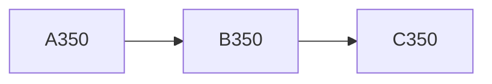

## セクション 351

これは段落 351 です。**太字**や *斜体*、`code`、[リンク](https://example.com) を含みます。

- 項目 A
- 項目 B
  - ネスト
- [ ] タスク

| 列 1 | 列 2 | 列 3 |
| --- | --- | --- |
| 351 | 702 | 1053 |

## セクション 352

これは段落 352 です。**太字**や *斜体*、`code`、[リンク](https://example.com) を含みます。

- 項目 A
- 項目 B
  - ネスト
- [ ] タスク

| 列 1 | 列 2 | 列 3 |
| --- | --- | --- |
| 352 | 704 | 1056 |

## セクション 353

これは段落 353 です。**太字**や *斜体*、`code`、[リンク](https://example.com) を含みます。

- 項目 A
- 項目 B
  - ネスト
- [ ] タスク

| 列 1 | 列 2 | 列 3 |
| --- | --- | --- |
| 353 | 706 | 1059 |

## セクション 354

これは段落 354 です。**太字**や *斜体*、`code`、[リンク](https://example.com) を含みます。

- 項目 A
- 項目 B
  - ネスト
- [ ] タスク

| 列 1 | 列 2 | 列 3 |
| --- | --- | --- |
| 354 | 708 | 1062 |

## セクション 355

これは段落 355 です。**太字**や *斜体*、`code`、[リンク](https://example.com) を含みます。

- 項目 A
- 項目 B
  - ネスト
- [ ] タスク

| 列 1 | 列 2 | 列 3 |
| --- | --- | --- |
| 355 | 710 | 1065 |

## セクション 356

これは段落 356 です。**太字**や *斜体*、`code`、[リンク](https://example.com) を含みます。

- 項目 A
- 項目 B
  - ネスト
- [ ] タスク

| 列 1 | 列 2 | 列 3 |
| --- | --- | --- |
| 356 | 712 | 1068 |

## セクション 357

これは段落 357 です。**太字**や *斜体*、`code`、[リンク](https://example.com) を含みます。

- 項目 A
- 項目 B
  - ネスト
- [ ] タスク

| 列 1 | 列 2 | 列 3 |
| --- | --- | --- |
| 357 | 714 | 1071 |

## セクション 358

これは段落 358 です。**太字**や *斜体*、`code`、[リンク](https://example.com) を含みます。

- 項目 A
- 項目 B
  - ネスト
- [ ] タスク

| 列 1 | 列 2 | 列 3 |
| --- | --- | --- |
| 358 | 716 | 1074 |

## セクション 359

これは段落 359 です。**太字**や *斜体*、`code`、[リンク](https://example.com) を含みます。

- 項目 A
- 項目 B
  - ネスト
- [ ] タスク

| 列 1 | 列 2 | 列 3 |
| --- | --- | --- |
| 359 | 718 | 1077 |

## セクション 360

これは段落 360 です。**太字**や *斜体*、`code`、[リンク](https://example.com) を含みます。

- 項目 A
- 項目 B
  - ネスト
- [ ] タスク

| 列 1 | 列 2 | 列 3 |
| --- | --- | --- |
| 360 | 720 | 1080 |

```js
function f360(x) {
  return x * 360
}
```

数式 $x_{360} = \sqrt{360}$
