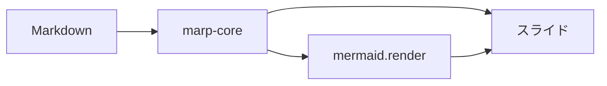
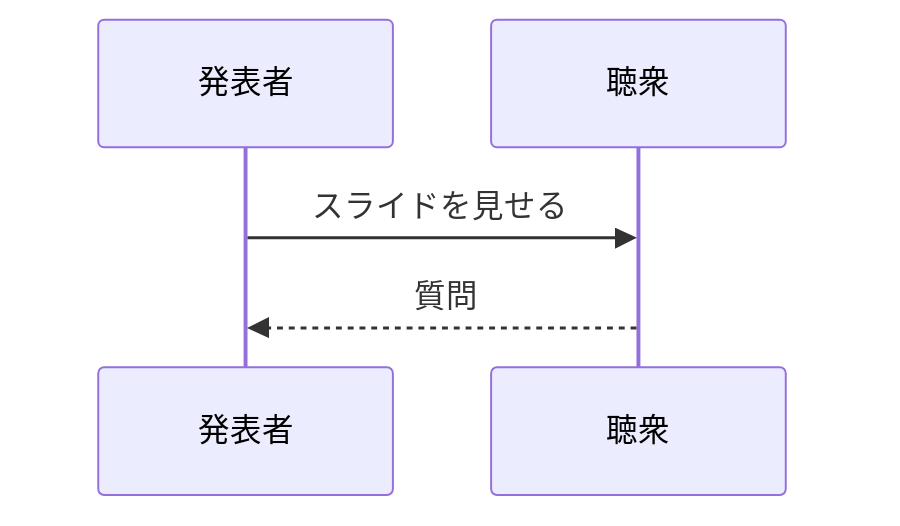

<style>
section {
  font-family: 'Hiragino Sans', 'Noto Sans JP', sans-serif;
}
section.accent {
  background: linear-gradient(135deg, #1f6feb, #8250df);
  color: #fff;
}
section.accent h1 {
  color: #fff;
}
.small {
  font-size: 0.6em;
  opacity: 0.8;
}
</style>

<!-- _class: lead -->

# Marp スライドのサンプル

テーマ指定・カスタム CSS・スライド内 mermaid

---

## 箇条書きとコード

- テーマ: `gaia`（`default` / `uncover` も可）
- `<style>` でカスタム CSS
- `paginate: true` でページ番号

```ts
const marp = new Marp({ html: true })
const { html, css } = marp.render(markdown)
```

---

<!-- _class: accent -->

# カスタムクラス

`<!-- _class: accent -->` でこのスライドだけにスタイルを適用

<p class="small">.small クラスで小さい文字</p>

---

## スライド内の Mermaid



---

## シーケンス図



---

## 数式

$$
f(x) = \int_{-\infty}^{\infty} \hat{f}(\xi)\, e^{2 \pi i \xi x} \, d\xi
$$

インライン: $a^2 + b^2 = c^2$

---

<!-- _paginate: false -->

# ありがとうございました 🎉
