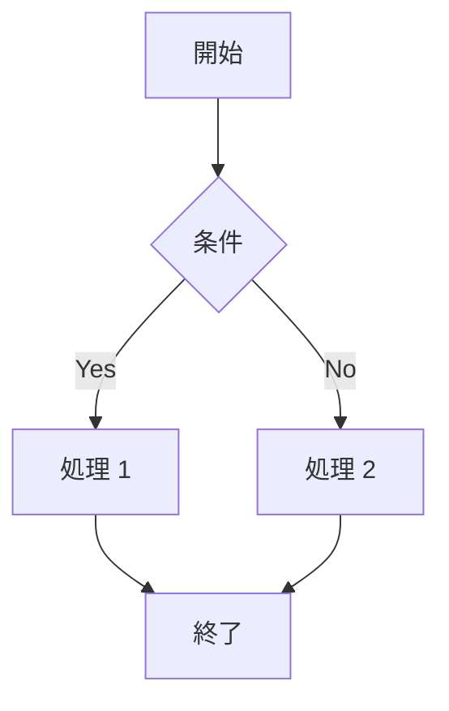
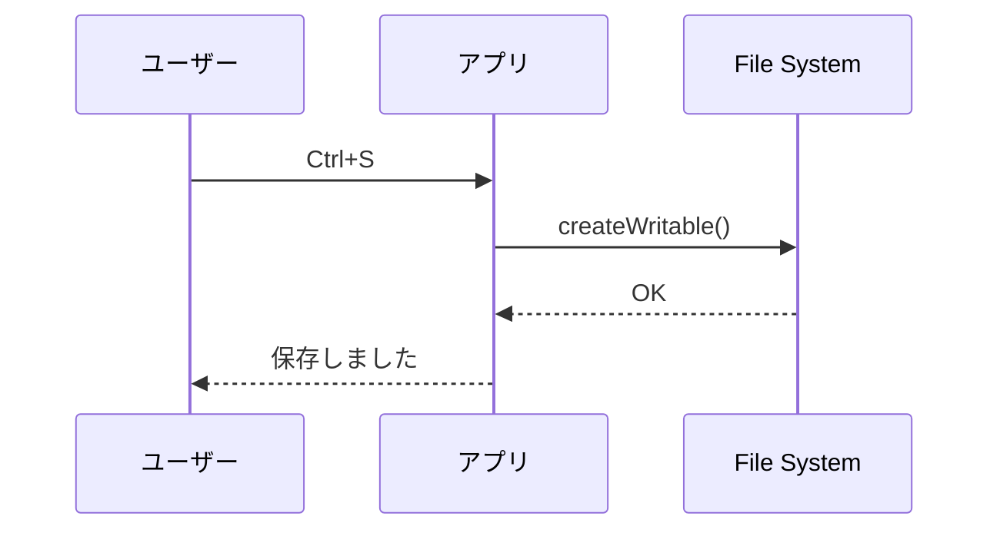
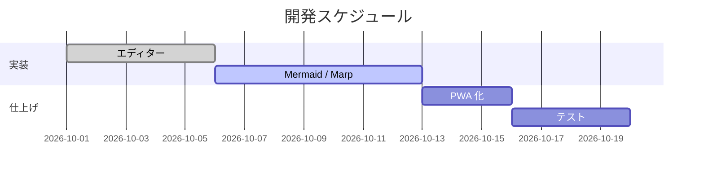
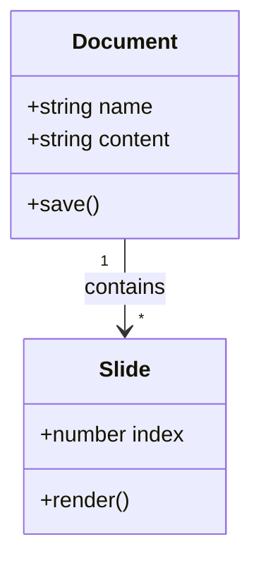
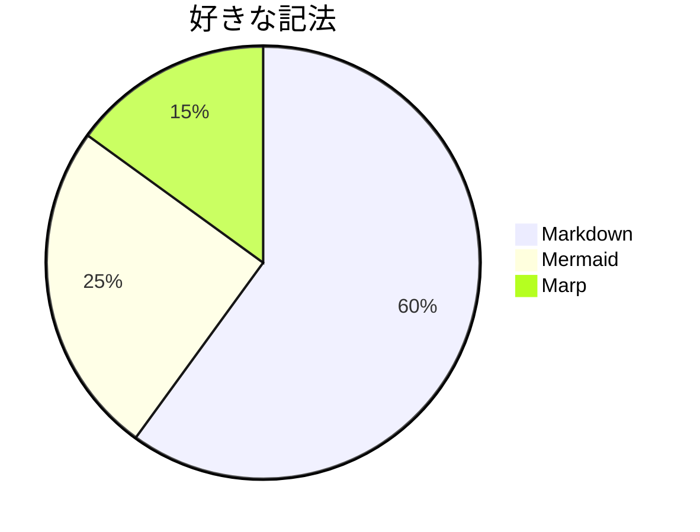

# Mermaid サンプル

## flowchart



## sequenceDiagram



## gantt



## classDiagram



## 意図的な構文エラー

下の図はエラーメッセージが表示され、アプリ全体は動き続けます。

```mermaid
flowchart TD
  A[開始] --> --> B
  this is not valid mermaid
```

## エラーの後も描画が続くことの確認


